<div align="center">

# 📷 OnviPi

**Turn a Raspberry Pi and a USB webcam into an ONVIF camera for Home Assistant**

Shows up in Home Assistant as an **ONVIF camera with live view _and_ motion sensor** –
local, no cloud, no subscription.

[](https://github.com/GERGto/OnviPi/releases/latest)
[](https://github.com/GERGto/OnviPi/actions/workflows/release.yml)
[](LICENSE)

**[⬇️ Download OnviPiOS](https://github.com/GERGto/OnviPi/releases/latest/download/onvipios-arm64.img.xz)** ·
**[📦 All releases](https://github.com/GERGto/OnviPi/releases)** ·
**[📝 Changelog](CHANGELOG.md)**

</div>

---

- 📹 **Live view** via ONVIF/WebRTC (go2rtc) with low latency
- 🟢 **Local motion detection** as an ONVIF event – ideal for light and alarm automations
- 🎥 **Several webcams on one Pi:** each one becomes its own camera in Home Assistant
- ⏺️ **Local recording** to a USB stick/SSD or the SD card, with a gallery in the browser
- 🕶️ **Motion areas, privacy masks, sound** and an optional low-resolution second stream
- 📶 **Setup from your phone:** hotspot with a step-by-step wizard, no SSH needed
- 🧭 **Tidy web interface** for phone and desktop – simple by default, expert mode on demand
- 💿 **OnviPiOS:** ready-to-flash image based on Raspberry Pi OS Lite
- 🔒 **Everything stays on your network,** credentials are stored only on the Pi

## Contents

1. [Requirements](#1-requirements)
2. [Installation](#2-installation)
3. [Add to Home Assistant](#3-add-to-home-assistant)
4. [Setup wizard](#4-setup-wizard)
5. [Configuration](#5-configuration)
6. [How it works](#6-how-it-works)
7. [Troubleshooting](#7-troubleshooting)
8. [Security](#8-security)
9. [Development](#9-development)

---

## 1. Requirements

### Hardware

| Component | Requirement |
|---|---|
| **Raspberry Pi** | **Raspberry Pi 4 Model B or Raspberry Pi 5** with 1 GB RAM or more (both tested). Pi 3B+ and Zero 2 W are untested and probably too slow for software encoding. |
| **SD card** | microSD with 8 GB or more, class A1 or better recommended |
| **Power supply** | official USB-C power supply 5 V / 3 A – Pi and webcam need a stable supply |
| **Webcam** | USB webcam following the UVC standard (“driverless”). Ideal: MJPEG or H.264 at 1280×720. YUYV-only cameras run at 640×480. |
| **Recording (optional)** | USB stick or SSD (ext4, exFAT, FAT32 or NTFS – it is not formatted). Recording to the SD card works too but wears it out. |
| **Network** | Wi-Fi (2.4 or 5 GHz) or Ethernet. The setup hotspot uses 2.4 GHz. USB Wi-Fi adapters (e.g. with an external antenna) are supported if Raspberry Pi OS has a driver for them. |

### Software

| Component | Requirement |
|---|---|
| **Operating system** | OnviPiOS: included in the image. Package: Raspberry Pi OS Lite **64-bit**, Bookworm or Trixie (with NetworkManager) |
| **Home Assistant** | a current version with the built-in **ONVIF integration**, on the same network as the camera (multicast allowed) |
| **For setup** | a phone or laptop with Wi-Fi; for OnviPiOS also a computer with [Raspberry Pi Imager](https://www.raspberrypi.com/software/) |

### Load (Pi 4)

Software encoding (libx264) uses **about one of the four CPU cores at 1280×720 and 30 fps**; a
heatsink is recommended. **Every additional webcam needs about the same again** – two to
three cameras are realistic on a Pi 4. Higher resolutions have not been measured – reduce
resolution or frame rate under high load. Motion detection only runs while Home Assistant is subscribed to
events or recording on motion is switched on. 1 GB of RAM is not the bottleneck.

---

## 2. Installation

| Method | For | Download |
|---|---|---|
| **A – OnviPiOS image** | a new device, set up entirely from your phone | [`onvipios-arm64.img.xz`](https://github.com/GERGto/OnviPi/releases/latest/download/onvipios-arm64.img.xz) |
| **B – Package** | an existing Raspberry Pi OS with SSH access | [`onvipi.tar.gz`](https://github.com/GERGto/OnviPi/releases/latest/download/onvipi.tar.gz) |

Checksums are published as `SHA256SUMS` with each [release](https://github.com/GERGto/OnviPi/releases/latest).

### A – OnviPiOS image

1. **[Download OnviPiOS](https://github.com/GERGto/OnviPi/releases/latest/download/onvipios-arm64.img.xz)**.
2. Write it to the SD card with [Raspberry Pi Imager](https://www.raspberrypi.com/software/):
   *Device* → your Raspberry Pi model, *Operating system* → **Use custom**. Answer **No** when asked
   about OS customisation – user, SSH and Wi-Fi are set in the wizard.
3. Plug in the webcam and power on the Pi. After **2–3 minutes** the open Wi-Fi
   **`OnviPi-Setup-XXXX`** appears – even if an Ethernet cable is connected.
4. Join it with your phone. The wizard opens automatically (otherwise go to `http://10.42.0.1`):
   **Camera → Password → Network → Save your details** – see [Setup wizard](#4-setup-wizard).
   On Ethernet you can also open `http://onvipi-xxxx.local` from your computer instead.

Afterwards the settings page is reachable at `http://onvipi-<name>.local` with the password
you chose.

### B – Package on an existing Raspberry Pi OS

Requires Raspberry Pi OS Lite 64-bit (Bookworm or Trixie) with SSH access.

```bash
curl -fsSL https://github.com/GERGto/OnviPi/releases/latest/download/onvipi.tar.gz | tar xz
sudo bash onvipi/install.sh "Garden"        # "Garden" = camera name
```

The installer installs the packages, downloads go2rtc, detects the webcam (format, resolution,
frame rate), generates a random password and starts all services. At the end it prints the
credentials; they are also stored in `/etc/onvipi/onvipi.conf`. Change the password on the
settings page under *System*. (The package keeps your existing Linux user; the wizard is only
used on OnviPiOS.)

**Update:** run the same two commands again – settings are kept.

| Option | Effect |
|---|---|
| `sudo WIFI_COUNTRY=GB bash onvipi/install.sh …` | Wi-Fi country (default `DE`) |
| `sudo MQTT_USER=… MQTT_PASSWORD=… bash onvipi/install.sh …` | optional MQTT diagnostic sensors |

**Check:** open `http://<pi>.local:1984` in a browser → *Streams → onvipi*.

### Coming from PiCam?

OnviPi was previously called **PiCam**. Installing the package on a PiCam device migrates it
automatically: settings, camera password and Wi-Fi networks are kept, and Home Assistant keeps
the device (the ONVIF device ID does not change). The old configuration is kept as a backup in
`/etc/picam.migrated-<date>`.

---

## 3. Add to Home Assistant

Each camera registers via ONVIF – **one device with live view and motion sensor per webcam**:

1. **Settings → Devices & services → Add integration → ONVIF**
2. The camera should appear in the scan. If not, choose *Configure manually* with
   **Host** = IP of the Pi, **Port** `8000`, **Username** `admin`, **Password** = your password.
3. Done: you get a **camera entity** (live view via WebRTC) and a
   **`binary_sensor` “Motion”**.
4. With several webcams repeat this for each one (ports `8000`, `8001`, …). The page
   *Home Assistant* of the settings interface lists names and ports.

> [!NOTE]
> Home Assistant does **not** list ONVIF cameras under “Discovered” on its own – add the
> integration once as shown above. Afterwards HA recognises the camera by its device ID, even
> with a new IP or after switching between Ethernet and Wi-Fi. HA and the Pi must be on the
> same network and multicast must not be blocked (no guest Wi-Fi).

The buttons Home Assistant creates for every ONVIF camera work as follows:

| Button | Effect |
|---|---|
| **Reboot** | restarts the whole Raspberry Pi (all cameras) |
| **Set system date and time** | sets the Pi's clock from Home Assistant – only applied while the Pi has no NTP time (network without internet) |

**IP address in Home Assistant:** the *Visit* link on the device page opens the settings page,
which shows the address. The built-in ONVIF integration has no IP sensor; with the optional
MQTT connection (expert mode → *Home Assistant*) IP address, CPU temperature and Wi-Fi signal
appear as sensors inside the same device.

---

## 4. Setup wizard

The wizard is open while **no account** exists (freshly flashed OnviPiOS). The Pi then opens
the Wi-Fi `OnviPi-Setup-…`; on Ethernet the wizard is also reachable at
`http://onvipi-xxxx.local`. Join the Wi-Fi with your phone – the wizard opens on its own
(otherwise go to `http://10.42.0.1`). It asks only for what is really needed; everything else
has a default behind *More options*.

<table>
  <tr>
    <td width="230" valign="top">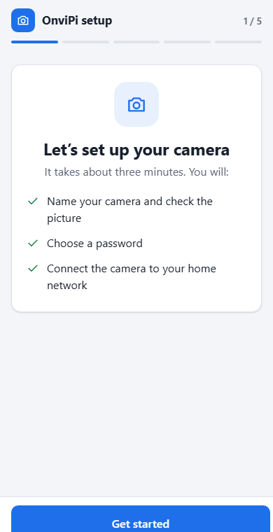</td>
    <td valign="top">
      <h4>1 · Welcome</h4>
      A short overview of what the wizard does. Nothing to enter yet.
    </td>
  </tr>
  <tr>
    <td valign="top">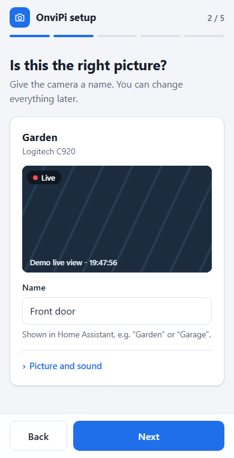</td>
    <td valign="top">
      <h4>2 · Camera</h4>
      You see the live picture right away. Give the camera a name – it appears in Home
      Assistant and becomes the hostname (<code>onvipi-&lt;name&gt;.local</code>). With several
      webcams each one is listed and can be named or switched off.<br><br>
      <i>Picture options</i> holds orientation, timestamp, format, resolution and frame rate.
    </td>
  </tr>
  <tr>
    <td valign="top">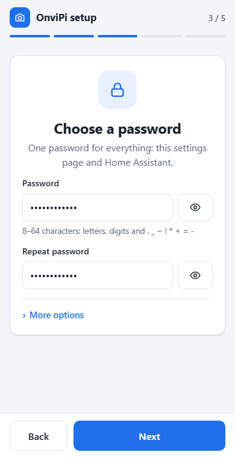</td>
    <td valign="top">
      <h4>3 · Password</h4>
      <b>One</b> account for everything: settings page, Home Assistant (ONVIF/RTSP) and the
      login on the Pi (terminal, SSH). The username is <code>admin</code> unless you change it
      under <i>More options</i>.
    </td>
  </tr>
  <tr>
    <td valign="top">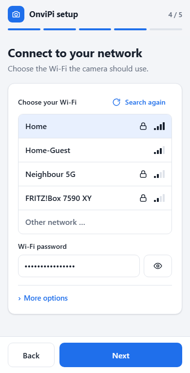</td>
    <td valign="top">
      <h4>4 · Network</h4>
      Pick your Wi-Fi and enter its password. <b>With a network cable plugged in this step is
      already done</b> – Wi-Fi is optional then. If a USB Wi-Fi adapter is connected you can
      choose which adapter to use. Time zone and Wi-Fi country are preselected from your
      phone and can be changed under <i>More options</i>.
    </td>
  </tr>
  <tr>
    <td valign="top">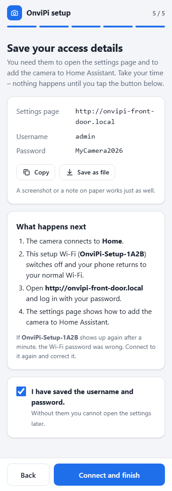</td>
    <td valign="top">
      <h4>5 · Save your details</h4>
      Address, username and password on one page – copy them, save them as a file or take a
      screenshot. <b>Nothing happens until you confirm that you saved them</b>; only then the
      camera connects to your Wi-Fi and the setup hotspot switches off.
    </td>
  </tr>
  <tr>
    <td valign="top">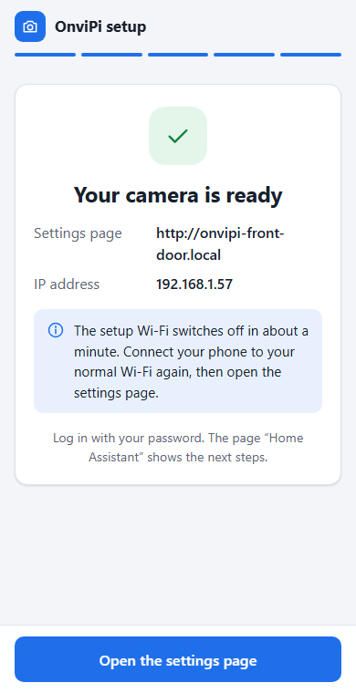</td>
    <td valign="top">
      <h4>Done</h4>
      On Ethernet (or with a second Wi-Fi adapter) the page shows the result and the new
      address. With the built-in Wi-Fi only, your phone returns to your normal Wi-Fi – open
      <code>http://onvipi-&lt;name&gt;.local</code> and log in.<br><br>
      If the hotspot appears again, the Wi-Fi password was wrong: connect again, the wizard
      reopens at the network step and has kept your other answers.
    </td>
  </tr>
</table>

<sub>All data shown in the screenshots are examples from the simulated device.</sub>

**Lost Wi-Fi later?** If a set-up camera finds no network for five minutes it opens the hotspot
again. It then shows the normal settings page (with login) – choose another Wi-Fi under
*Network*. Start the hotspot by hand with `sudo onvipi-wifi portal`.

**Forgot the password?** Put the SD card into a computer, create an empty file named
`onvipi-reset` on the boot partition and start the Pi. The wizard opens again and asks for a
new password; cameras and network settings are kept.

---

## 5. Configuration

### Settings page

The settings page is at **`http://<pi>.local`** (port 80) – log in with your password.

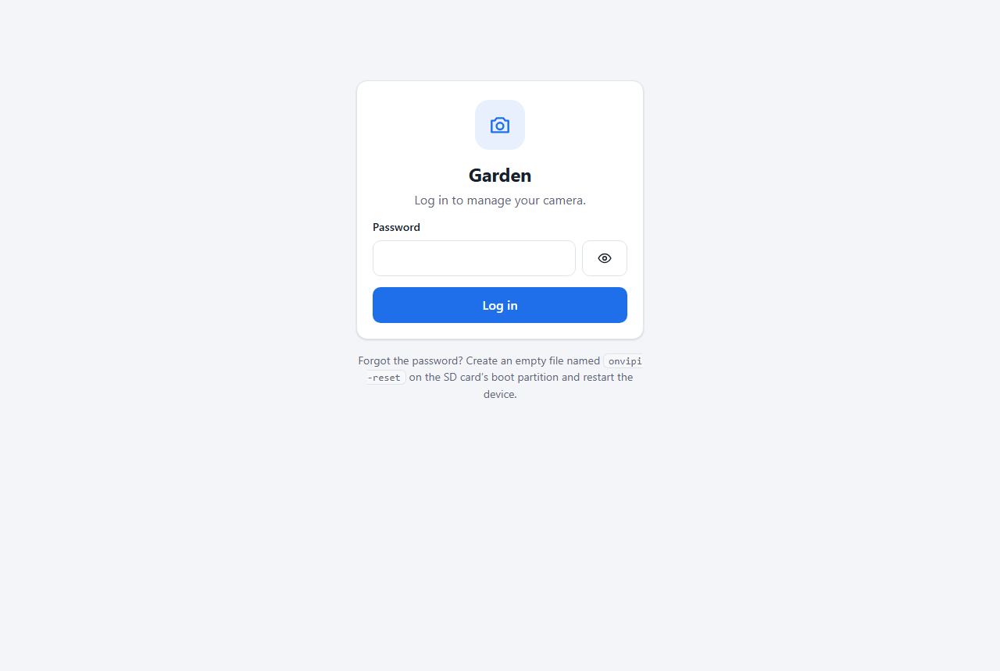

<table>
  <tr>
    <td valign="top">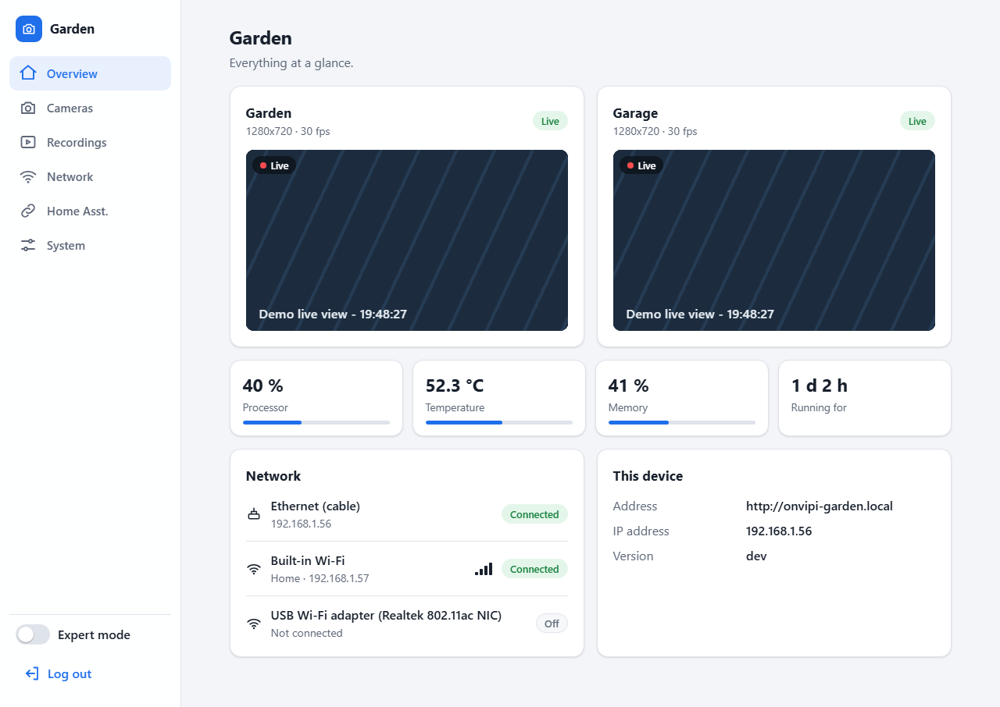</td>
  </tr>
</table>
<table>
  <tr>
    <td valign="top">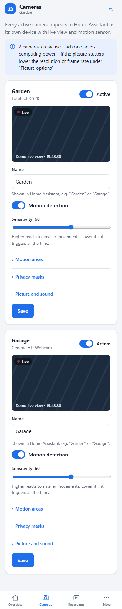</td>
    <td valign="top">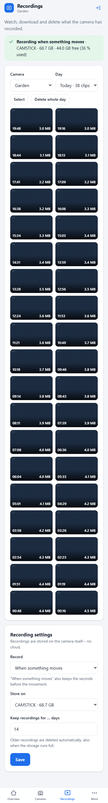</td>
    <td valign="top">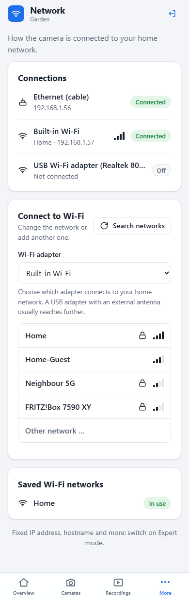</td>
  </tr>
</table>

| Page | Content | Additionally in expert mode |
|---|---|---|
| **Overview** | live pictures, warnings (power supply, heat, missing camera), load, network | |
| **Cameras** | per webcam: on/off, name, motion detection with sensitivity and **motion areas**, **privacy masks**, picture and sound options; newly plugged webcams can be added | ONVIF port, RTSP address, device ID |
| **Recordings** | gallery of the recorded clips by camera and day: watch, download, delete (single, several, a whole day); recording settings | |
| **Network** | connections, connect to another Wi-Fi, choose the Wi-Fi adapter, forget networks | DHCP or fixed IP per connection, hostname, Wi-Fi country |
| **Home Assistant** | step-by-step instructions for adding the cameras | MQTT diagnostic sensors |
| **System** | password, time zone, restart, log download, **update**, **backup / restore**, **factory reset** | SSH on/off |
| **Terminal** | | command line in the browser ([ttyd](https://github.com/tsl0922/ttyd)) |

- **Expert mode** is a switch at the bottom of the menu. It only shows or hides settings.
- **Like an app:** on a phone, choose *Add to Home Screen* in the browser menu – the settings
  page then opens full screen with its own icon.
- **Live view:** overview and camera cards show the live stream (WebRTC, falling back to
  MSE/MP4) through the settings page itself – no extra port needs to be opened in the browser.
- **Fixed IP without lock-out:** new IP settings must be confirmed by reaching the page again
  (this happens automatically). Otherwise the previous settings return after three minutes.
- **Terminal:** off by default. It is switched on for a limited time (15 minutes to 2 hours)
  and switches itself off afterwards and on every restart. It is only reachable through the
  logged-in settings page.
- After 5 failed logins the address is blocked for 10 minutes.

> [!TIP]
> **Remote access:** a VPN (for example WireGuard on your router) is the safest way – nothing is
> exposed to the internet. Forwarding port 80 works but sends the password **unencrypted**.
> **Never** forward ports `1984`, `8554` or `8000`.

### Recording

Switch it on under *Recordings*:

| Setting | Meaning |
|---|---|
| **Record** | *When something moves* (keeps the seconds before the movement as well) or *All the time* |
| **Store on** | a USB stick/SSD, or the **SD card (internal)**. USB storage is recommended for recording all the time; on the SD card OnviPi always keeps 15 % (at least 2 GB) free for the system. |
| **Keep recordings for … days** | older clips are deleted automatically – also earlier when the storage runs full (ring buffer) |

The existing H.264 stream is written as it is (no re-encoding, hardly any CPU load) in clips of
one minute (motion) or five minutes (continuous). The files are ordinary MP4s under
`onvipi/<camera>/YYYYMMDD-HHMMSS.mp4` on the storage (SD card: `/var/lib/onvipi/recordings`), so
a USB stick can also be read on any computer. Recording works without Home Assistant and
without internet. ONVIF Profile G (playback through ONVIF) is not provided – Home Assistant does
not use it.

### Picture, sound and detection

Per camera on the *Cameras* page:

- **Motion areas** – draw rectangles on the picture; only movement inside counts (path yes,
  street and trees no). Without areas the whole picture counts.
- **Privacy masks** – blacked-out rectangles, e.g. the neighbour's garden. They are burnt into
  the picture before encoding, so they are also hidden in Home Assistant and in recordings.
- **Sound** – if the webcam has a microphone it can be switched on (Opus; off by default).
  It is heard in WebRTC/RTSP players and stored in recordings.
- **Extra low-resolution stream** – a second stream (640 px wide) for slow connections. It is a
  second ONVIF profile; Home Assistant adds it as an additional camera entity that is disabled
  until you enable it. It only uses CPU while somebody watches it.

### Update, backup and reset

- **Update:** *System → Check for updates* asks GitHub for the latest release and installs it
  with one click (checksum verified, settings kept). This is the only time OnviPi contacts the
  internet, and only when you press the button.
- **Backup / restore:** one JSON file with all settings (cameras, network, password, MQTT).
  It contains passwords – keep it private. Restored on a replacement device, the cameras keep
  their IDs, so Home Assistant keeps recognising them.
- **Factory reset:** deletes cameras, network, name and (on OnviPiOS) the account and restarts
  with the setup wizard. Recordings are kept.

### Several webcams

Every webcam is one entry in `/etc/onvipi/cameras.json` and its own ONVIF device: own port
(`8000`, `8001`, …), own device ID, own stream (`rtsp://<pi>:8554/onvipi`, `/cam2`, …) and own
motion detection. Up to four cameras can be active. Webcams are recognised by their USB
identity, so the assignment survives restarts and re-plugging; a missing webcam is shown as
“not connected”.

### onvipi.conf

Device-wide settings are stored in `/etc/onvipi/onvipi.conf`
(afterwards run `sudo systemctl restart onvipi-go2rtc onvipi-onvif`):

| Key | Meaning |
|---|---|
| `CAM_NAME` | name of the device (first camera) |
| `CAM_USER`, `CAM_PASSWORD` | the account: settings page, RTSP and ONVIF. Change the password on the settings page – it also updates the Linux login created by the wizard (`LOGIN_USER`). |
| `BITRATE` | H.264 bitrate (default `2500k`) |
| `HW_ENCODE` | `0` = software encoder (**default**). `1` = hardware encoder – saves CPU but **freezes WebRTC in the browser**; only RTSP works then. Pi 4 only (the Pi 5 has no hardware encoder). |
| `MOTION_FPS`, `MOTION_COOLDOWN`, `MOTION_THRESHOLD` | fine-tuning of the motion detection (on/off and sensitivity are per camera) |
| `ONVIF_PORT` | port of the first ONVIF device (default `8000`) |
| `WIFI_IFACE` | Wi-Fi adapter for the home network (set on the *Network* page) |
| `REC_MODE`, `REC_UUID`, `REC_DAYS` | recording: `off`/`motion`/`continuous`, storage (file system UUID or `local` = SD card), days to keep |
| `UPDATE_REPO` | GitHub repository used by the update function (default `GERGto/OnviPi`) |
| `AP_SSID`, `AP_PASSWORD` | setup hotspot (empty password = open) |
| `WIFI_COUNTRY` | Wi-Fi country |
| `HOSTNAME_AUTO` | `1` = the hostname follows the camera name in the wizard |

Per-camera settings (`name`, `device`, `format`, `size`, `fps`, `rotate`, `overlay`, `motion`,
`sensitivity`, `motion_zones`, `privacy`, `audio`, `substream`, `port`) are in `cameras.json`. Installations from before 2.1 are converted
automatically; the first camera keeps its ID, so Home Assistant keeps the device.

### Commands

```bash
sudo onvipi-wifi status     # network, hotspot, account and cameras
sudo onvipi-wifi reset      # forget saved Wi-Fi networks → hotspot
sudo onvipi-wifi portal     # start the hotspot right away
systemctl status onvipi-go2rtc onvipi-onvif onvipi-wsd onvipi-wifi onvipi-record
```

**Ports:** settings page `80` · RTSP `8554` (password protected) · go2rtc `1984` ·
WebRTC `8555` · ONVIF `8000` (+1 per additional camera)

---

## 6. How it works

### Components and data flow

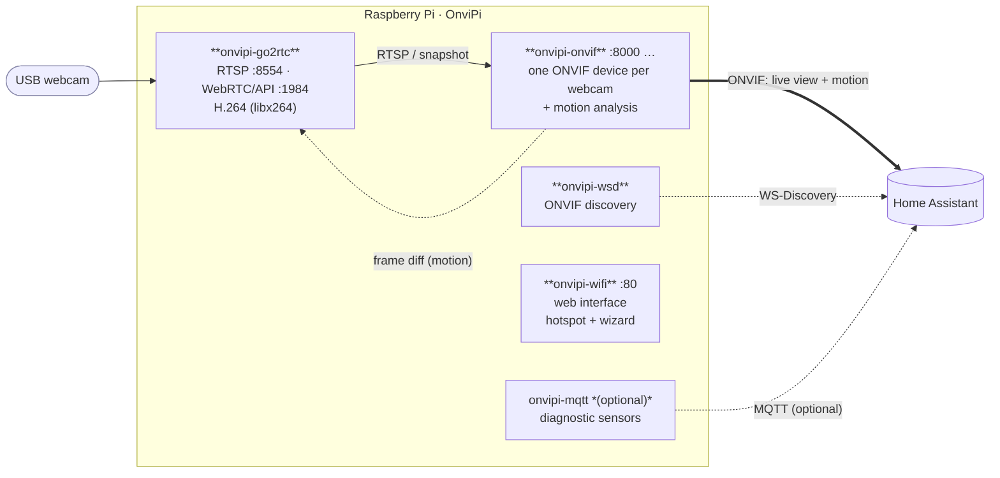

### Startup

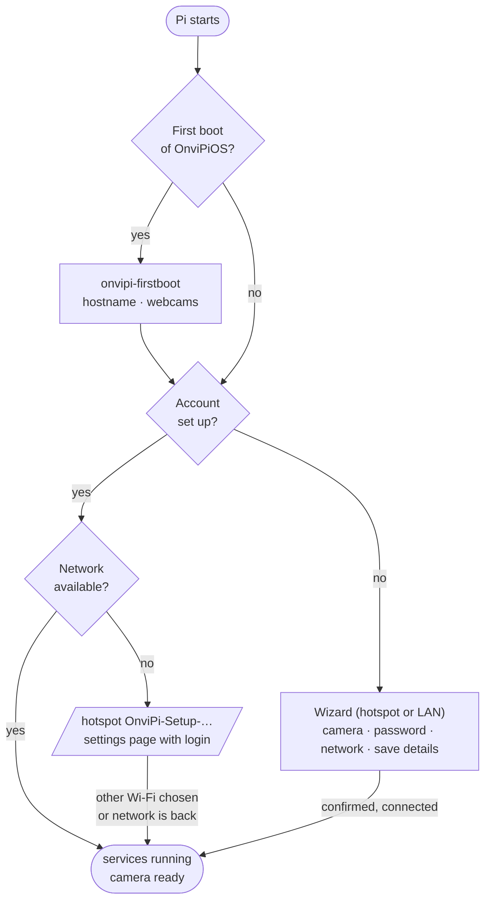

### Motion in Home Assistant (ONVIF events)

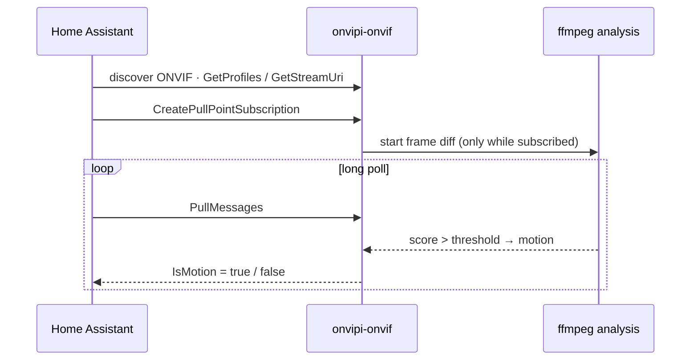

**Why a separate ONVIF server?** go2rtc's built-in ONVIF does not support motion events.
`onvipi-onvif` speaks ONVIF itself (device, media, events) and points to go2rtc for the video –
so Home Assistant gets **one** device with live view _and_ motion, without an MQTT broker.

**How is motion detected?** ffmpeg extracts tiny grayscale frames (64×36) from the stream and
`onvipi-onvif` measures the mean pixel difference between two frames. If it exceeds the
threshold derived from the camera's sensitivity (with debouncing), it counts as motion. The analysis
runs **only while Home Assistant is subscribed to events or recording on motion is switched on** –
that saves power and CPU.

### Services

| Service | Purpose |
|---|---|
| `onvipi-go2rtc` | video: camera → H.264, RTSP, WebRTC, snapshot |
| `onvipi-onvif` | ONVIF server: one device per webcam (live view reference, motion events, reboot) |
| `onvipi-wsd` | ONVIF discovery (makes the camera discoverable in HA) |
| `onvipi-wifi` | web interface (settings, wizard, terminal), hotspot |
| `onvipi-record` | recording to USB storage or SD card, ring buffer (idle while recording is off) |
| `onvipi-mqtt` | *optional:* diagnostic sensors (CPU temperature, Wi-Fi, IP) via MQTT |
| `onvipi-firstboot` | *OnviPiOS only:* one-time setup on first boot |

---

## 7. Troubleshooting

| Symptom | Cause / solution |
|---|---|
| **Hotspot does not appear (OnviPiOS)** | The first boot takes longer (file system is expanded, one reboot). Wait 5 minutes. Connect a screen and check `journalctl -u onvipi-firstboot -u onvipi-wifi`. |
| **Hotspot does not appear (configured device)** | The hotspot only starts without a network. On Ethernet: `sudo onvipi-wifi portal`. |
| **Password forgotten** | Create an empty file `onvipi-reset` on the SD card's boot partition and restart – the wizard asks for a new one. If OS customisation was set in Raspberry Pi Imager, the Pi counts as set up immediately: the generated password is in `/etc/onvipi/onvipi.conf` (`CAM_PASSWORD`). |
| **Second webcam does not show up** | Open *Cameras* and add it. Two identical webcams without serial number are told apart by their USB port – keep them on the same ports. |
| **Locked out after changing the IP** | Wait three minutes: unconfirmed IP settings are reverted automatically. |
| **Recording is not running** | The *Recordings* page and the overview show the reason. USB storage must contain a file system (ext4, exFAT, FAT32, NTFS). Watch with `journalctl -u onvipi-record -f`. |
| **No sound** | Switch it on under *Cameras → Picture and sound*; the option only appears when the webcam's microphone is recognised (`arecord -l`). Home Assistant plays sound only with WebRTC. |
| **Update fails** | The Pi needs internet access for an update. Details: *System → Download log* or `journalctl -u onvipi-update`. |
| **Terminal page says “not installed”** | The package `ttyd` was not available during installation: `sudo apt install ttyd`. |
| **Live view runs briefly, then freezes** | `HW_ENCODE='1'` is set – change it to `0`. |
| **Stuttering picture / high CPU** | reduce resolution or frame rate under *Cameras → Picture options*, or switch a camera off. |
| **No picture** | `http://<pi>:1984` → *Streams*. Check format and resolution under *Cameras*. |
| **Motion never / always triggers** | adjust the sensitivity under *Cameras*; watch with `journalctl -u onvipi-onvif -f`. |
| **HA does not find the camera** | same network? multicast allowed? Otherwise add ONVIF *manually*: host `<Pi IP>`, port `8000`. |
| **Added in HA, but no live view** | wrong credentials (HA also uses them for RTSP). Choose *Reconfigure* on the ONVIF device and enter `admin` + password. |
| **“Unexpected error” in the ONVIF setup** | check `journalctl -u onvipi-onvif` for “Unknown ONVIF operation”. |

---

## 8. Security

- **No shared secrets in the image:** SSH host keys and device ID (`machine-id`) are generated
  on every device at first boot; the password is chosen by you in the wizard.
- **One account.** The wizard is open only while no account exists. Afterwards everything –
  also on the hotspot – requires the login. The password can be reset only with physical
  access to the SD card (`onvipi-reset`).
- **SSH and the browser terminal are off** until you enable them in expert mode; the terminal
  only for a limited time.
- **RTSP, ONVIF and the settings page** are protected with username and password
  (`/etc/onvipi/onvipi.conf`, mode `0640`). The settings page uses a session cookie
  (`HttpOnly`, `SameSite=Strict`), locks out after failed logins and only accepts changes from
  itself.
- **The web interface uses plain HTTP.** Use it in your home network or through a VPN.
- **The ONVIF service runs unprivileged.** Reboot and clock setting go through a small helper
  that `sudo` allows for exactly these two actions.
- **go2rtc on port `1984`** is reachable on your network without a password – never forward it
  to the internet.
- **Recordings and backups stay on the device.** The gallery is only reachable after login. A
  backup file contains your passwords.
- **No cloud service.** The only outgoing connection is to GitHub when you press *Check for
  updates* / *Install*; the downloaded package is verified against the release checksum.

---

## 9. Development

### Repository layout

| Path | Content |
|---|---|
| [`onvipi/`](onvipi) | package content: `install.sh`, services (`pi/`), systemd units, NetworkManager config |
| [`onvipi/pi/web/`](onvipi/pi/web) | web interface: wizard (`setup.*`), settings (`index.html`, `app.js`), shared `ui.*` – plain HTML/CSS/JS, no build step |
| [`tools/dev-server.py`](tools/dev-server.py) | runs the web interface with a simulated device on your computer |
| [`onvipi/setup/base.sh`](onvipi/setup/base.sh) | device-independent part (packages, go2rtc, files) – for the image **and** `install.sh` |
| [`onvipi/setup/firstboot.sh`](onvipi/setup/firstboot.sh) | device-specific part (password, hostname, webcam) – first boot or `install.sh` |
| [`onvipi/setup/migrate.sh`](onvipi/setup/migrate.sh) | takes over an existing PiCam installation |
| [`image/build-image.sh`](image/build-image.sh) | builds OnviPiOS from Raspberry Pi OS Lite arm64 (chroot, native on arm64) |
| [`tools/package.sh`](tools/package.sh) | builds `onvipi.tar.gz` |
| [`tools/release-notes.sh`](tools/release-notes.sh) | generates the release notes from the changelog |
| [`.github/workflows/release.yml`](.github/workflows/release.yml) | builds both and publishes the release |

### Working on the web interface

No Raspberry Pi is needed – the real server and pages run against a simulated device:

```bash
python tools/dev-server.py            # settings interface, http://localhost:8080 (password: onvipi-dev)
python tools/dev-server.py --setup    # setup wizard; Wi-Fi password "wrongpass" simulates a failure
```

Options: `--cameras N`, `--no-ethernet`, `--usb-wifi`, `--port`.

### Creating a release

1. Add a section for the new version to [`CHANGELOG.md`](CHANGELOG.md)
   (heading `## [2.1] – YYYY-MM-DD`).
2. Tag and push:
   ```bash
   git tag v2.1 && git push origin v2.1
   ```
3. GitHub Actions builds the image and the package on an arm64 runner (about 15–25 minutes) and
   publishes the release with `onvipios-arm64.img.xz`, `onvipi.tar.gz` and `SHA256SUMS`.
   The release notes come from the changelog, plus the download links.

For a test run without a release use *Actions → Release → Run workflow*. The files are then
attached to the run as artifacts.

---

## License

MIT – see [LICENSE](LICENSE). go2rtc and Raspberry Pi OS are subject to their own licenses.
OnviPiOS is based on Raspberry Pi OS but is not an official Raspberry Pi Ltd product.
“Home Assistant” is a trademark of its respective owner; OnviPi is an independent project.
