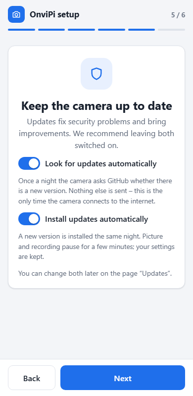
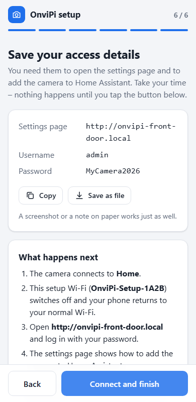
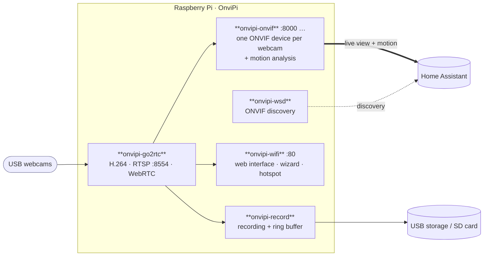

<div align="center">

# 📷 OnviPi

**Turn a Raspberry Pi and USB webcams into ONVIF cameras for Home Assistant**

Live view, motion sensor and local recording – no cloud, no subscription.

[](https://github.com/GERGto/OnviPi/releases/latest)
[](https://github.com/GERGto/OnviPi/actions/workflows/release.yml)
[](LICENSE)

**[⬇️ Download OnviPiOS](https://github.com/GERGto/OnviPi/releases/latest/download/onvipios-arm64.img.xz)** ·
**[📦 All releases](https://github.com/GERGto/OnviPi/releases)** ·
**[📝 Changelog](CHANGELOG.md)**

</div>

---

- 📹 **Live view and motion sensor** in Home Assistant via ONVIF
- 🎥 **Several webcams on one Pi** – each one is its own camera
- ⏺️ **Local recording** to USB storage or the SD card, with a gallery in the browser
- 🕶️ **Motion areas, privacy masks, sound** and an optional low-resolution stream
- 📶 **Setup from your phone** with a short wizard – no SSH, no keyboard
- 🧭 **App-like web interface** for phone and desktop, simple by default, expert mode on demand

## Contents

1. [Requirements](#1-requirements) · 2. [Installation](#2-installation) ·
3. [Setup wizard](#3-setup-wizard) · 4. [Home Assistant](#4-home-assistant) ·
5. [Web interface](#5-web-interface) · 6. [Reference](#6-reference) ·
7. [Troubleshooting](#7-troubleshooting) · 8. [Security](#8-security) ·
9. [Development](#9-development)

---

## 1. Requirements

| | |
|---|---|
| **Raspberry Pi** | Pi 4 or Pi 5 with 1 GB RAM or more (both tested). Pi 3B+ and Zero 2 W are untested and probably too slow. |
| **Webcam** | USB webcam (UVC, “driverless”). Ideal: MJPEG or H.264 at 1280×720. |
| **SD card, power** | 8 GB or more; official USB-C power supply (5 V / 3 A) |
| **Network** | Ethernet or Wi-Fi. USB Wi-Fi adapters work if Raspberry Pi OS has a driver. |
| **Recording** *(optional)* | USB stick or SSD (ext4, exFAT, FAT32, NTFS – it is not formatted), or the SD card |
| **Home Assistant** *(optional)* | current version, on the same network (multicast allowed, no guest Wi-Fi) |

One webcam at 1280×720 / 30 fps needs about one of the four CPU cores (software encoding); every
further webcam about the same again. Two to three cameras are realistic. A heatsink is
recommended.

---

## 2. Installation

### A – OnviPiOS image (new device)

1. **[Download OnviPiOS](https://github.com/GERGto/OnviPi/releases/latest/download/onvipios-arm64.img.xz)**
   and write it to the SD card with [Raspberry Pi Imager](https://www.raspberrypi.com/software/)
   (*Operating system → Use custom*). Answer **No** to OS customisation.
2. Plug in the webcam(s) and power on the Pi. After 2–3 minutes the Wi-Fi
   **`OnviPi-Setup-XXXX`** appears.
3. Join it with your phone – the [wizard](#3-setup-wizard) opens by itself (otherwise:
   `http://10.42.0.1`). On Ethernet you can use `http://onvipi-xxxx.local` from a computer instead.

### B – Package (existing Raspberry Pi OS Lite 64-bit, Bookworm or Trixie)

```bash
curl -fsSL https://github.com/GERGto/OnviPi/releases/latest/download/onvipi.tar.gz | tar xz
sudo bash onvipi/install.sh "Garden"        # "Garden" = camera name
```

The installer prints the generated password; change it under *System*. Your Linux user is kept.
Run the same commands again to update. Options: `WIFI_COUNTRY=GB`, `MQTT_USER=… MQTT_PASSWORD=…`.
An existing **PiCam** installation (former name) is migrated automatically.

Checksums: `SHA256SUMS` in each [release](https://github.com/GERGto/OnviPi/releases/latest).

---

## 3. Setup wizard

Five short steps; everything else has a sensible default behind *More options*.

<table>
  <tr>
    <td valign="top"></td>
    <td valign="top"></td>
    <td valign="top"></td>
    <td valign="top"></td>
    <td valign="top"></td>
  </tr>
</table>

| Step | What happens |
|---|---|
| **Camera** | You see the live picture. Name the camera – the name appears in Home Assistant and becomes the address `onvipi-<name>.local`. Several webcams are listed one below the other. |
| **Password** | One account for everything: web interface, Home Assistant and the login on the Pi. Username `admin` unless changed. |
| **Network** | Choose your Wi-Fi. With a network cable this step is already done. A USB Wi-Fi adapter can be selected here. |
| **Updates** | Two switches, both on by default: look for updates automatically, and install them automatically. |
| **Save your details** | Address, username and password on one page. Nothing changes until you confirm that you saved them – only then the camera connects and the setup Wi-Fi switches off. |

- **Wrong Wi-Fi password?** The setup Wi-Fi comes back and the wizard reopens at the network
  step with your other answers kept.
- **Lost Wi-Fi later?** After five minutes without network the hotspot opens again – now
  protected with **your password as the Wi-Fi key**. It shows the normal web interface (with
  login); choose another Wi-Fi under *Network*.
- **Forgot the password?** Create an empty file `onvipi-reset` on the SD card's boot partition
  and restart. The wizard asks for a new one; cameras and network are kept.

---

## 4. Home Assistant

1. **Settings → Devices & services → Add integration → ONVIF**
2. Select the camera, enter the username `admin` and your password.
   Not listed? *Configure manually*: host = IP of the Pi, port `8000`.
3. Repeat for further webcams (ports `8001`, `8002`, …).

You get a **camera entity** and a **motion sensor** per webcam. Afterwards Home Assistant finds
the camera by its ID, even with a new IP address. The page *Home Assistant* of the web interface
shows these steps with your names and ports.

| In Home Assistant | Effect |
|---|---|
| Button **Reboot** | restarts the whole Raspberry Pi |
| Button **Set system date and time** | sets the Pi's clock – only applied without NTP time (network without internet) |
| Link **Visit** | opens the web interface |
| Second camera entity (disabled) | the optional low-resolution stream, if switched on |

The ONVIF integration has no IP sensor. With the optional MQTT connection (expert mode →
*Home Assistant*) IP address, CPU temperature and Wi-Fi signal appear as sensors in the same device.

---

## 5. Web interface

`http://onvipi-<name>.local` – log in with your password. On a phone it behaves like an app
(fixed title and tab bar); *Add to Home Screen* in the browser menu gives it its own icon.

<table>
  <tr>
    <td valign="top"></td>
    <td valign="top"></td>
    <td valign="top"></td>
  </tr>
</table>

| Page | Content | Additionally in expert mode |
|---|---|---|
| **Overview** | live view, warnings (power, heat, missing camera), load, network | |
| **Cameras** | on/off, name, motion detection, motion areas, privacy masks, picture and sound | ONVIF port, RTSP address, device ID |
| **Recordings** | gallery by camera and day: watch, download, delete; recording settings | |
| **Network** | connections, change Wi-Fi, choose the Wi-Fi adapter | fixed IP, hostname, Wi-Fi country |
| **Home Assistant** | instructions with your names and ports | MQTT sensors |
| **Updates** | installed version, check for updates, automatic updates on/off | |
| **System** | password, time zone, restart, log, backup/restore, factory reset | SSH |
| **Terminal** | | command line in the browser, switched on for a limited time |

### Cameras

- **Motion areas** – draw rectangles on the picture; only movement inside counts.
- **Privacy masks** – blacked-out rectangles, also hidden in Home Assistant and in recordings.
- **Sound** – from the webcam's microphone (off by default).
- **Extra low-resolution stream** – 640 px wide, for slow connections; uses CPU only while watched.

### Recording

| Setting | Meaning |
|---|---|
| **Record** | *When something moves* (including the seconds before) or *All the time* |
| **Store on** | USB stick/SSD or the SD card. USB is recommended for recording all the time – the SD card wears out. |
| **Overwrite after … days** | older recordings are deleted automatically |
| **Use at most … GB** | optional limit for all recordings together |

**The storage cannot run full.** Free space is checked every two seconds. When it gets short,
the oldest recordings go first – even before the days are over. A reserve always stays free
(USB: 5 %, at least 500 MB · SD card: 15 %, at least 2 GB). If other data fills the storage,
recording pauses and continues by itself. Only OnviPi's own recordings are ever deleted, and
without the USB storage nothing is written to the SD card instead.

Clips are ordinary MP4 files (`onvipi/<camera>/YYYYMMDD-HHMMSS.mp4`), written without re-encoding.
A USB stick can be read on any computer.

### Network, update, backup

- **Fixed IP without lock-out:** unconfirmed IP settings are reverted after three minutes.
- **Updates:** two switches (wizard and page *Updates*), both on by default. *Look for
  updates automatically* asks GitHub once a night (between 3:00 and 4:30); *Install updates
  automatically* installs a new release the same night – checksum verified, settings and
  recordings kept. With the first one off, OnviPi never contacts the internet on its own.
- **Backup / restore:** one file with all settings – it contains your passwords. Restored on a
  replacement device, Home Assistant keeps recognising the cameras.
- **Factory reset:** back to the setup wizard. Recordings are kept.

> [!TIP]
> **Remote access:** use a VPN (e.g. WireGuard on your router). The web interface uses plain
> HTTP – never forward its port or ports `8554`, `8000` to the internet.

---

## 6. Reference

### How it works



go2rtc encodes the webcam pictures once; ONVIF, recording and the live view in the browser all
use that stream. OnviPi brings its own ONVIF server because go2rtc's has no motion events.
Motion is detected by comparing small grayscale frames; the analysis only runs while Home
Assistant is subscribed or recording on motion is switched on.

### Files and commands

| | |
|---|---|
| `/etc/onvipi/onvipi.conf` | device settings: account (`CAM_USER`, `CAM_PASSWORD`), `BITRATE`, `HW_ENCODE` (Pi 4 only; freezes WebRTC), `ONVIF_PORT`, `WIFI_IFACE`, `WIFI_COUNTRY`, `AP_SSID`, `AP_PASSWORD`, `REC_MODE`, `REC_UUID`, `REC_DAYS`, `REC_MAX_GB`, `MOTION_FPS`, `MOTION_COOLDOWN`, `UPDATE_CHECK`, `UPDATE_AUTO`, `UPDATE_REPO`, `TRUSTED_HOSTS`, `GO2RTC_LAN` |
| `/etc/onvipi/cameras.json` | one entry per webcam: name, source, resolution, rotation, motion, zones, sound, port, ID |
| `sudo onvipi-wifi status` | network, hotspot, account and cameras |
| `sudo onvipi-wifi portal` | start the hotspot right away |
| `sudo onvipi-wifi reset` | forget saved Wi-Fi networks |
| `journalctl -u 'onvipi-*' -f` | watch the log (also: *System → Download log*) |

**Ports:** web interface `80` · ONVIF and snapshot `8000` (+1 per camera) · RTSP `8554` · WebRTC `8555`.
go2rtc's own page (`1984`) is only reachable on the Pi itself.
**Streams:** `rtsp://admin:<password>@<pi>:8554/onvipi`, `/cam2`, … (low resolution: `…_sub`).

---

## 7. Troubleshooting

| Symptom | Solution |
|---|---|
| **Setup Wi-Fi does not appear** | The first boot takes up to 5 minutes. On a set-up device the hotspot only starts without network (`sudo onvipi-wifi portal`). |
| **Password forgotten** | File `onvipi-reset` on the boot partition, restart. |
| **HA shows no still picture** | After updating to 2.3 choose *Reconfigure* on the ONVIF device once (the snapshot address changed); the live view is not affected. |
| **“This address is not allowed”** | Open the camera by its IP address or as `http://<name>.local`. For another name (reverse proxy), add it as `TRUSTED_HOSTS='cam.example.org'` to `onvipi.conf`. |
| **HA does not find the camera** | Same network, no guest Wi-Fi; otherwise add it manually with host and port. |
| **Added in HA, but no picture** | Wrong password – choose *Reconfigure* on the ONVIF device. |
| **Picture stutters / Pi is hot** | Lower resolution or frame rate under *Cameras → Picture and sound*, or switch a camera off. |
| **Motion never / always triggers** | Adjust sensitivity and motion areas under *Cameras*. |
| **Second webcam missing** | Open *Cameras* and add it. Identical webcams without serial number must stay on the same USB ports. |
| **Recording is not running** | The *Recordings* page shows the reason. USB storage needs a file system (ext4, exFAT, FAT32, NTFS). |
| **No sound** | Switch it on under *Cameras*; the option only appears if the microphone is recognised. HA plays sound only with WebRTC. |
| **Locked out after changing the IP** | Wait three minutes – the previous settings come back. |
| **Update fails** | The Pi needs internet access. *Updates* shows the reason; details with `journalctl -u onvipi-autoupdate -u onvipi-update`. |
| **Terminal “not installed”** | `sudo apt install ttyd` |

---

## 8. Security

OnviPi is built for the home network. What protects it:

| Area | Protection |
|---|---|
| **Account** | One password for web interface, ONVIF, RTSP and snapshots. The wizard is open only while no account exists; resetting the password needs physical access to the SD card. |
| **Guessing passwords** | Web interface: 5 wrong attempts lock the address for 10 minutes. ONVIF and snapshots: 10 wrong attempts lock it for 5 minutes. |
| **Web interface** | Session cookie (`HttpOnly`, `SameSite=Strict`), changes only accepted from the page itself, Content-Security-Policy, and only the device's own addresses are accepted as host name (stops DNS-rebinding attacks from websites you visit). |
| **Video** | RTSP, ONVIF and snapshots need the password. go2rtc's unprotected management interface is bound to the Pi itself; live view goes through the web interface with login. |
| **Hotspot** | The hotspot of a set-up device is WPA2-encrypted with your password, so the login cannot be read by someone in range. |
| **Services** | ONVIF, video and discovery run as an unprivileged user; reboot and clock setting go through a helper that `sudo` allows for exactly these two actions. SSH and the browser terminal are off until you enable them. |
| **Updates** | Downloaded over HTTPS from the project's GitHub releases and verified against the published checksum. |
| **Image** | Nothing shared between devices: SSH host keys and device ID are generated on first boot. |

Known limits – please keep them in mind:

- **Plain HTTP.** Web interface, ONVIF and RTSP are not encrypted. Anyone who can listen to your
  home network can read the password. Use a VPN for remote access; never forward ports.
- **The setup Wi-Fi is open.** During the few minutes of the wizard, someone within Wi-Fi range
  could read what you type (the new password, your Wi-Fi key) or run the wizard before you do.
  For a sensitive environment, set the camera up over a network cable.
- **One password for everything.** Home Assistant stores it; whoever knows it controls the camera.
- **RTSP has no lock-out** (it is go2rtc's server) – use a password that is not guessable.
- **Updates are trusted by their source,** not by a separate signature: whoever controls the
  GitHub repository can ship software to devices with automatic updates on.
- **The web interface runs as root** (it manages network and accounts). It is the part to keep
  away from untrusted networks.

Found a security problem? Please report it privately via GitHub *Security → Report a
vulnerability* instead of a public issue.

---

## 9. Development

| Path | Content |
|---|---|
| [`onvipi/pi/`](onvipi/pi) | services (Python, standard library only) |
| [`onvipi/pi/web/`](onvipi/pi/web) | web interface – plain HTML/CSS/JS, no build step |
| [`onvipi/setup/`](onvipi/setup) | `base.sh` (packages, files), `firstboot.sh` (per device), `migrate.sh` (PiCam) |
| [`image/build-image.sh`](image/build-image.sh) | builds OnviPiOS from Raspberry Pi OS Lite arm64 |
| [`tools/dev-server.py`](tools/dev-server.py) | runs the web interface with a simulated device – no Pi needed |

```bash
python tools/dev-server.py            # web interface, http://localhost:8080 (password: onvipi-dev)
python tools/dev-server.py --setup    # setup wizard; Wi-Fi password "wrongpass" simulates a failure
```

**Release:** add a section `## [x.y] – YYYY-MM-DD` to [`CHANGELOG.md`](CHANGELOG.md), then
`git tag vx.y && git push origin vx.y`. GitHub Actions builds image and package (about 20
minutes) and publishes them; the release notes come from the changelog.

---

## License

MIT – see [LICENSE](LICENSE). go2rtc and Raspberry Pi OS are subject to their own licenses.
OnviPiOS is based on Raspberry Pi OS but is not an official Raspberry Pi Ltd product.
“Home Assistant” is a trademark of its respective owner; OnviPi is an independent project.
