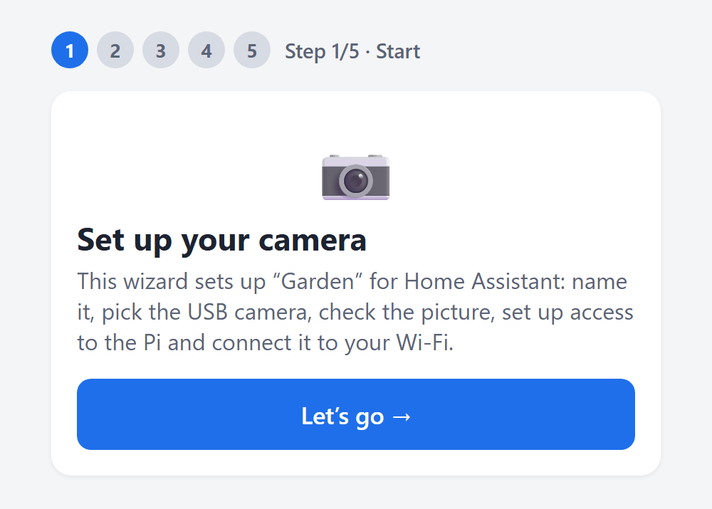
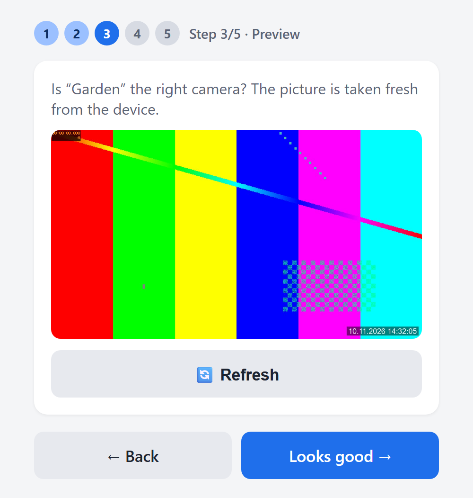
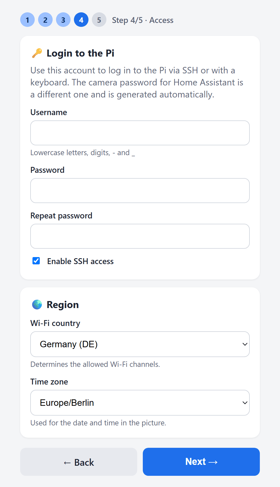
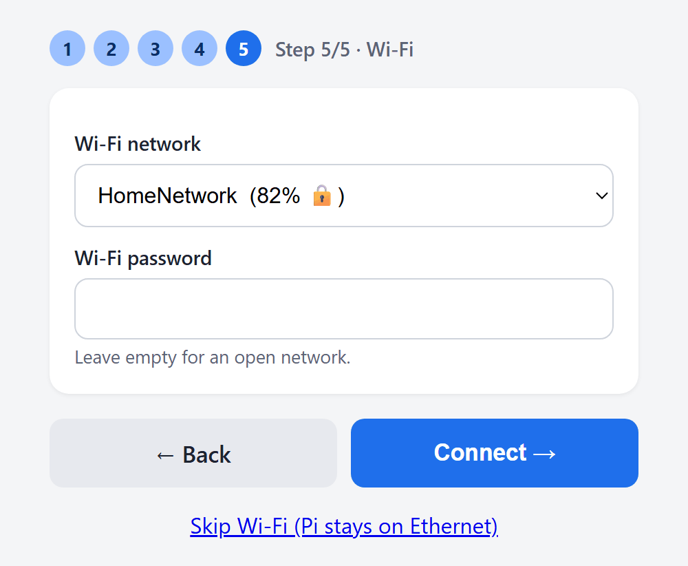
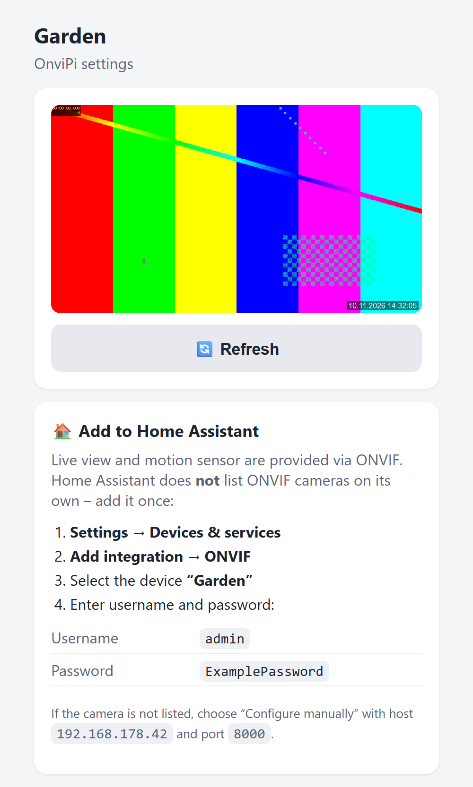
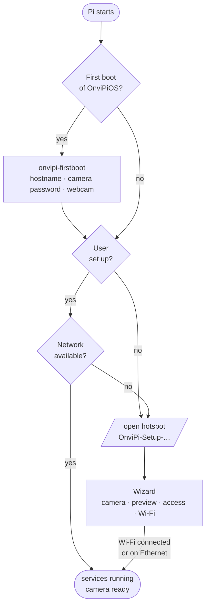
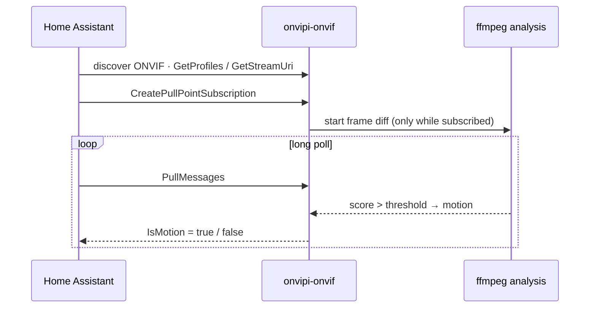

<div align="center">

# 📷 OnviPi

**Turn a Raspberry Pi and a USB webcam into an ONVIF camera for Home Assistant**

Shows up in Home Assistant as an **ONVIF camera with live view _and_ motion sensor** –
local, no cloud, no subscription.

[](https://github.com/GERGto/OnviPi/releases/latest)
[](https://github.com/GERGto/OnviPi/actions/workflows/release.yml)
[](LICENSE)

**[⬇️ Download OnviPiOS](https://github.com/GERGto/OnviPi/releases/latest/download/onvipios-arm64.img.xz)** ·
**[📦 All releases](https://github.com/GERGto/OnviPi/releases)** ·
**[📝 Changelog](CHANGELOG.md)**

</div>

---

- 📹 **Live view** via ONVIF/WebRTC (go2rtc) with low latency
- 🟢 **Local motion detection** as an ONVIF event – ideal for light and alarm automations
- 📶 **Setup from your phone:** hotspot with a step-by-step wizard, no SSH needed
- 💿 **OnviPiOS:** ready-to-flash image based on Raspberry Pi OS Lite
- 🔒 **Everything stays on your network,** credentials are stored only on the Pi

## Contents

1. [Requirements](#1-requirements)
2. [Installation](#2-installation)
3. [Add to Home Assistant](#3-add-to-home-assistant)
4. [Setup wizard](#4-setup-wizard)
5. [Configuration](#5-configuration)
6. [How it works](#6-how-it-works)
7. [Troubleshooting](#7-troubleshooting)
8. [Security](#8-security)
9. [Development](#9-development)

---

## 1. Requirements

### Hardware

| Component | Requirement |
|---|---|
| **Raspberry Pi** | **Raspberry Pi 4 Model B with 1 GB RAM or more** (tested). The Raspberry Pi 5 should work as well but is untested. Pi 3B+ and Zero 2 W are untested and probably too slow for software encoding. |
| **SD card** | microSD with 8 GB or more, class A1 or better recommended |
| **Power supply** | official USB-C power supply 5 V / 3 A – Pi and webcam need a stable supply |
| **Webcam** | USB webcam following the UVC standard (“driverless”). Ideal: MJPEG or H.264 at 1280×720. YUYV-only cameras run at 640×480. |
| **Network** | Wi-Fi (2.4 or 5 GHz) or Ethernet. The setup hotspot uses 2.4 GHz. |

### Software

| Component | Requirement |
|---|---|
| **Operating system** | OnviPiOS: included in the image. Package: Raspberry Pi OS Lite **64-bit**, Bookworm or Trixie (with NetworkManager) |
| **Home Assistant** | a current version with the built-in **ONVIF integration**, on the same network as the camera (multicast allowed) |
| **For setup** | a phone or laptop with Wi-Fi; for OnviPiOS also a computer with [Raspberry Pi Imager](https://www.raspberrypi.com/software/) |

### Load (Pi 4)

Software encoding (libx264) uses **about one of the four CPU cores at 1280×720 and 30 fps**; a
heatsink is recommended. Higher resolutions have not been measured – reduce `VIDEO_SIZE` or
`FRAMERATE` under high load. Motion detection only runs while Home Assistant is subscribed to
events. 1 GB of RAM is not the bottleneck.

---

## 2. Installation

| Method | For | Download |
|---|---|---|
| **A – OnviPiOS image** | a new device, set up entirely from your phone | [`onvipios-arm64.img.xz`](https://github.com/GERGto/OnviPi/releases/latest/download/onvipios-arm64.img.xz) |
| **B – Package** | an existing Raspberry Pi OS with SSH access | [`onvipi.tar.gz`](https://github.com/GERGto/OnviPi/releases/latest/download/onvipi.tar.gz) |

Checksums are published as `SHA256SUMS` with each [release](https://github.com/GERGto/OnviPi/releases/latest).

### A – OnviPiOS image

1. **[Download OnviPiOS](https://github.com/GERGto/OnviPi/releases/latest/download/onvipios-arm64.img.xz)**.
2. Write it to the SD card with [Raspberry Pi Imager](https://www.raspberrypi.com/software/):
   *Device* → Raspberry Pi 4, *Operating system* → **Use custom**. Answer **No** when asked
   about OS customisation – user, SSH and Wi-Fi are set in the wizard.
3. Plug in the webcam and power on the Pi. After **2–3 minutes** the open Wi-Fi
   **`OnviPi-Setup-XXXX`** appears – even if an Ethernet cable is connected.
4. Join it with your phone. The wizard opens automatically (otherwise go to `http://10.42.0.1`):
   **Camera → Preview → Access → Wi-Fi** – see [Setup wizard](#4-setup-wizard) for every step.

Afterwards the camera is reachable at `http://onvipi-<name>.local`. At the end the wizard
shows the credentials for Home Assistant – take a screenshot.

### B – Package on an existing Raspberry Pi OS

Requires Raspberry Pi OS Lite 64-bit (Bookworm or Trixie) with SSH access.

```bash
curl -fsSL https://github.com/GERGto/OnviPi/releases/latest/download/onvipi.tar.gz | tar xz
sudo bash onvipi/install.sh "Garden"        # "Garden" = camera name
```

The installer installs the packages, downloads go2rtc, detects the webcam (format, resolution,
frame rate), generates a random password and starts all services. At the end it prints the
credentials; they are also stored in `/etc/onvipi/onvipi.conf`.

**Update:** run the same two commands again – settings are kept.

| Option | Effect |
|---|---|
| `sudo WIFI_COUNTRY=GB bash onvipi/install.sh …` | Wi-Fi country (default `DE`) |
| `sudo MQTT_USER=… MQTT_PASSWORD=… bash onvipi/install.sh …` | optional MQTT diagnostic sensors |

**Check:** open `http://<pi>.local:1984` in a browser → *Streams → onvipi*.

### Coming from PiCam?

OnviPi was previously called **PiCam**. Installing the package on a PiCam device migrates it
automatically: settings, camera password and Wi-Fi networks are kept, and Home Assistant keeps
the device (the ONVIF device ID does not change). The old configuration is kept as a backup in
`/etc/picam.migrated-<date>`.

---

## 3. Add to Home Assistant

The camera registers via ONVIF – **one device with live view and motion sensor**:

1. **Settings → Devices & services → Add integration → ONVIF**
2. The camera should appear in the scan. If not, choose *Configure manually* with
   **Host** = IP of the Pi, **Port** `8000`, **Username** `admin`, **Password** = camera password.
3. Done: you get a **camera entity** (live view via WebRTC) and a
   **`binary_sensor` “Motion”**.

> [!NOTE]
> Home Assistant does **not** list ONVIF cameras under “Discovered” on its own – add the
> integration once as shown above. Afterwards HA recognises the camera by its MAC address, even
> with a new IP. HA and the Pi must be on the same network and multicast must not be blocked
> (no guest Wi-Fi).

You find the **camera password** in the wizard, on the settings page or via SSH with
`sudo grep CAM_PASSWORD /etc/onvipi/onvipi.conf`.

---

## 4. Setup wizard

The Pi opens the **open** Wi-Fi `OnviPi-Setup-…` when

- **no user** has been set up yet (freshly flashed OnviPiOS) – immediately, even on Ethernet,
- or it finds **no network** at startup (no cable, no known Wi-Fi).

Join it with your phone – the wizard opens on its own (otherwise go to `http://10.42.0.1`):

<table>
  <tr>
    <td width="230" valign="top"></td>
    <td valign="top">
      <h4>1 · Start</h4>
      A short overview of what the wizard does. Nothing to enter yet.
    </td>
  </tr>
  <tr>
    <td valign="top"></td>
    <td valign="top">
      <h4>2 · Camera</h4>
      Give the camera a name – it appears in Home Assistant and becomes the hostname
      (<code>onvipi-&lt;name&gt;.local</code>). Choose the USB webcam, format, resolution and
      frame rate; only combinations the webcam supports are offered. Orientation and the
      timestamp in the picture can be set here as well.
    </td>
  </tr>
  <tr>
    <td valign="top"></td>
    <td valign="top">
      <h4>3 · Preview</h4>
      A fresh picture from the camera to check that it is the right one and correctly
      oriented. <i>(The screenshot shows a test pattern.)</i>
    </td>
  </tr>
  <tr>
    <td valign="top"></td>
    <td valign="top">
      <h4>4 · Access</h4>
      Create your login to the Pi (SSH or keyboard) and decide whether SSH is enabled.
      This is <b>not</b> the camera password for Home Assistant – that one is generated
      automatically.<br><br>
      The user can be created here <b>only once</b>. Afterwards this part is locked, so nobody
      within range of the open hotspot (e.g. during a Wi-Fi outage) can reset the password.
      SSH can be switched on and off later on the settings page.<br><br>
      Also set the Wi-Fi country (allowed channels) and the time zone (timestamp in the picture).
    </td>
  </tr>
  <tr>
    <td valign="top"></td>
    <td valign="top">
      <h4>5 · Wi-Fi</h4>
      Pick your network and enter the password. Hidden networks can be entered by name.
      If the Pi stays on Ethernet, choose <i>Skip Wi-Fi</i>.
    </td>
  </tr>
  <tr>
    <td valign="top"></td>
    <td valign="top">
      <h4>Done</h4>
      The hotspot switches off and your phone returns to your regular Wi-Fi. The page shows
      everything you need to <a href="#3-add-to-home-assistant">add the camera to Home Assistant</a>
      – take a screenshot of the credentials.<br><br>
      If the hotspot appears again, the Wi-Fi password was wrong – just connect and try again.
    </td>
  </tr>
</table>

<sub>All data shown in the screenshots are examples.</sub>

Start it manually – also on Ethernet:

```bash
sudo onvipi-wifi portal      # hotspot + wizard right away (stop with Ctrl-C)
```

---

## 5. Configuration

### Settings page

<table>
  <tr>
    <td width="230" valign="top"></td>
    <td valign="top">
      The settings page is at <b><code>http://&lt;pi&gt;.local</code></b> (port 80) – log in with
      username <code>admin</code> and the camera password.<br><br>
      It contains a live preview, instructions and credentials for Home Assistant, the camera
      settings (name, device, format, resolution, frame rate), motion detection, password
      change, network status, SSH on/off and “Restart services”.<br><br>
      After 5 failed logins the address is blocked for 10 minutes.
    </td>
  </tr>
</table>

> [!TIP]
> **Remote access:** a VPN (for example WireGuard on your router) is the safest way – nothing is
> exposed to the internet. Forwarding port 80 works but sends the password **unencrypted**.
> **Never** forward ports `1984`, `8554` or `8000`.

### onvipi.conf

All settings are stored in `/etc/onvipi/onvipi.conf`
(afterwards run `sudo systemctl restart onvipi-go2rtc onvipi-onvif`):

| Key | Meaning |
|---|---|
| `CAM_NAME` | display name of the camera |
| `CAM_USER`, `CAM_PASSWORD` | login for settings page, RTSP and ONVIF |
| `VIDEO_DEVICE`, `VIDEO_FORMAT`, `VIDEO_SIZE`, `FRAMERATE` | webcam source – detected automatically (prefers MJPEG 1280×720). If the configured webcam is missing at startup, it is detected again. |
| `ROTATE` | clockwise rotation: `0`, `90`/`270` (portrait), `180` (upside down). Costs some CPU. |
| `OVERLAY_TIME` | `1` = date/time in the bottom right corner, `0` = off |
| `BITRATE` | H.264 bitrate (default `2500k`) |
| `HW_ENCODE` | `0` = software encoder (**default**). `1` = hardware encoder – saves CPU but **freezes WebRTC in the browser**; only RTSP works then. |
| `MOTION_ENABLE`, `MOTION_SENSITIVITY` | motion detection on/off and sensitivity `0`–`100`. Fine-tuning: `MOTION_FPS`, `MOTION_COOLDOWN`, optional `MOTION_THRESHOLD`. |
| `ONVIF_PORT` | port of the ONVIF server (default `8000`) |
| `AP_SSID`, `AP_PASSWORD` | setup hotspot (empty password = open) |
| `WIFI_COUNTRY` | Wi-Fi country (changeable in the wizard) |
| `HOSTNAME_AUTO` | `1` = the hostname follows the camera name in the wizard |

### Commands

```bash
sudo onvipi-wifi status     # network, hotspot and user status
sudo onvipi-wifi reset      # forget saved Wi-Fi networks → setup mode
sudo onvipi-wifi portal     # start the wizard right away
systemctl status onvipi-go2rtc onvipi-onvif onvipi-wsd onvipi-wifi
```

**Ports:** settings page `80` · RTSP `8554` (password protected) · go2rtc `1984` ·
WebRTC `8555` · ONVIF `8000`

---

## 6. How it works

### Components and data flow


### Startup



### Motion in Home Assistant (ONVIF events)



**Why a separate ONVIF server?** go2rtc's built-in ONVIF does not support motion events.
`onvipi-onvif` speaks ONVIF itself (device, media, events) and points to go2rtc for the video –
so Home Assistant gets **one** device with live view _and_ motion, without an MQTT broker.

**How is motion detected?** ffmpeg extracts tiny grayscale frames (64×36) from the stream and
`onvipi-onvif` measures the mean pixel difference between two frames. If it exceeds the
threshold derived from `MOTION_SENSITIVITY` (with debouncing), it counts as motion. The analysis
runs **only while Home Assistant is subscribed to events** – that saves power and CPU.

### Services

| Service | Purpose |
|---|---|
| `onvipi-go2rtc` | video: camera → H.264, RTSP, WebRTC, snapshot |
| `onvipi-onvif` | ONVIF server (live view reference + motion events) |
| `onvipi-wsd` | ONVIF discovery (makes the camera discoverable in HA) |
| `onvipi-wifi` | settings page, hotspot and setup wizard |
| `onvipi-mqtt` | *optional:* diagnostic sensors (CPU temperature, Wi-Fi, IP) via MQTT |
| `onvipi-firstboot` | *OnviPiOS only:* one-time setup on first boot |

---

## 7. Troubleshooting

| Symptom | Cause / solution |
|---|---|
| **Hotspot does not appear (OnviPiOS)** | The first boot takes longer (file system is expanded, one reboot). Wait 5 minutes. Connect a screen and check `journalctl -u onvipi-firstboot -u onvipi-wifi`. |
| **Hotspot does not appear (configured device)** | The hotspot only starts without a network. On Ethernet: `sudo onvipi-wifi portal`. |
| **Camera password unknown** | Via SSH: `sudo grep CAM_PASSWORD /etc/onvipi/onvipi.conf`. If OS customisation was set in Raspberry Pi Imager, the Pi counts as set up immediately – the password is only stored there. |
| **Live view runs briefly, then freezes** | `HW_ENCODE='1'` is set – change it to `0`. |
| **Stuttering picture / high CPU** | reduce `VIDEO_SIZE` or `FRAMERATE`. |
| **No picture** | `http://<pi>:1984` → *Streams → onvipi*. Check `VIDEO_FORMAT`/`VIDEO_SIZE`. |
| **Motion never / always triggers** | adjust `MOTION_SENSITIVITY`; watch with `journalctl -u onvipi-onvif -f`. |
| **HA does not find the camera** | same network? multicast allowed? Otherwise add ONVIF *manually*: host `<Pi IP>`, port `8000`. |
| **Added in HA, but no live view** | wrong credentials (HA also uses them for RTSP). Delete the ONVIF entry and add it again with `admin` + password. |
| **“Unexpected error” in the ONVIF setup** | check `journalctl -u onvipi-onvif` for “Unknown ONVIF operation”. |

---

## 8. Security

- **No shared secrets in the image:** camera password, SSH host keys and device ID
  (`machine-id`) are generated on every device at first boot.
- **SSH is off** until you enable it in the wizard or on the settings page.
- **RTSP, ONVIF and the settings page** are protected with username and password (randomly
  generated, `/etc/onvipi/onvipi.conf`, mode `0640`). The settings page locks out after failed
  logins and only accepts forms from itself.
- **The wizard on the hotspot is open,** but it can only create a login user while none exists.
- **go2rtc on port `1984`** is reachable on your network without a password – never forward it
  to the internet.
- **No cloud service,** no outgoing connections except to your Home Assistant.

---

## 9. Development

### Repository layout

| Path | Content |
|---|---|
| [`onvipi/`](onvipi) | package content: `install.sh`, services (`pi/`), systemd units, NetworkManager config |
| [`onvipi/setup/base.sh`](onvipi/setup/base.sh) | device-independent part (packages, go2rtc, files) – for the image **and** `install.sh` |
| [`onvipi/setup/firstboot.sh`](onvipi/setup/firstboot.sh) | device-specific part (password, hostname, webcam) – first boot or `install.sh` |
| [`onvipi/setup/migrate.sh`](onvipi/setup/migrate.sh) | takes over an existing PiCam installation |
| [`image/build-image.sh`](image/build-image.sh) | builds OnviPiOS from Raspberry Pi OS Lite arm64 (chroot, native on arm64) |
| [`tools/package.sh`](tools/package.sh) | builds `onvipi.tar.gz` |
| [`tools/release-notes.sh`](tools/release-notes.sh) | generates the release notes from the changelog |
| [`.github/workflows/release.yml`](.github/workflows/release.yml) | builds both and publishes the release |

### Creating a release

1. Add a section for the new version to [`CHANGELOG.md`](CHANGELOG.md)
   (heading `## [2.1] – YYYY-MM-DD`).
2. Tag and push:
   ```bash
   git tag v2.1 && git push origin v2.1
   ```
3. GitHub Actions builds the image and the package on an arm64 runner (about 15–25 minutes) and
   publishes the release with `onvipios-arm64.img.xz`, `onvipi.tar.gz` and `SHA256SUMS`.
   The release notes come from the changelog, plus the download links.

For a test run without a release use *Actions → Release → Run workflow*. The files are then
attached to the run as artifacts.

---

## License

MIT – see [LICENSE](LICENSE). go2rtc and Raspberry Pi OS are subject to their own licenses.
OnviPiOS is based on Raspberry Pi OS but is not an official Raspberry Pi Ltd product.
“Home Assistant” is a trademark of its respective owner; OnviPi is an independent project.
