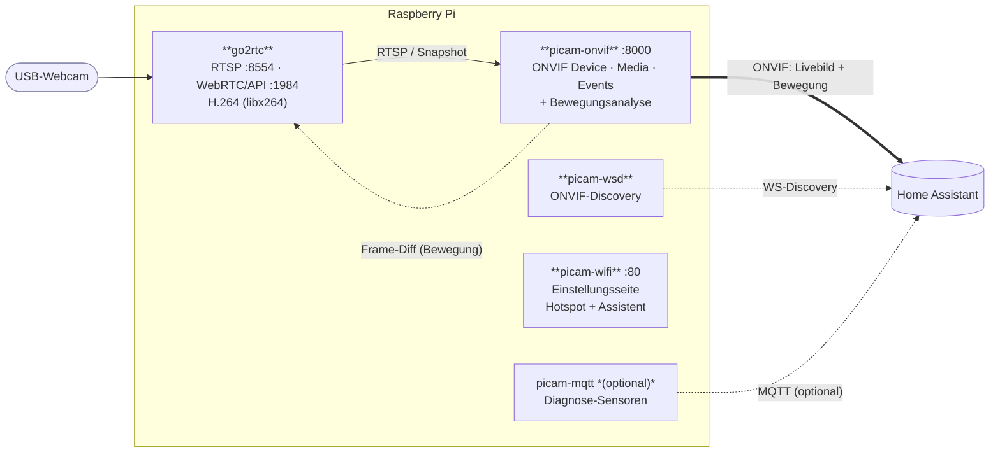
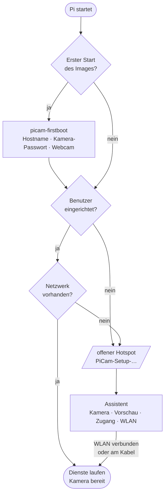
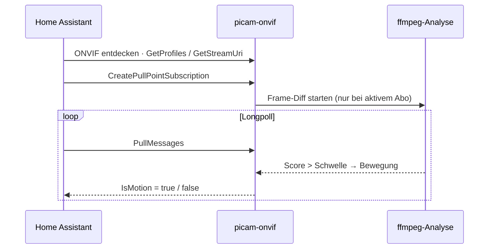

<div align="center">

# 📷 PiCam

**Raspberry Pi + USB-Webcam → Überwachungskamera für Home Assistant**

Meldet sich in Home Assistant als **ONVIF-Kamera mit Livebild _und_ Bewegungssensor** –
lokal, ohne Cloud, ohne Abo.

[](https://github.com/GERGto/PiCam/releases/latest)
[](https://github.com/GERGto/PiCam/actions/workflows/release.yml)
[](LICENSE)

**[⬇️ Image herunterladen](https://github.com/GERGto/PiCam/releases/latest/download/picam-arm64.img.xz)** ·
**[📦 Alle Releases](https://github.com/GERGto/PiCam/releases)** ·
**[📝 Änderungen](CHANGELOG.md)**

</div>

---

- 📹 **Livebild** über ONVIF/WebRTC (go2rtc), geringe Latenz
- 🟢 **Lokale Bewegungserkennung** als ONVIF-Ereignis – ideal für Licht- und Alarm-Automationen
- 📶 **Einrichtung per Handy:** Hotspot mit Schritt-für-Schritt-Assistent, kein SSH nötig
- 🔒 **Alles bleibt im Heimnetz,** Zugangsdaten liegen nur auf dem Pi

## Inhalt

1. [Installation](#1-installation)
2. [In Home Assistant einbinden](#2-in-home-assistant-einbinden)
3. [Einrichtungs-Assistent](#3-einrichtungs-assistent)
4. [Konfiguration](#4-konfiguration)
5. [Systemaufbau](#5-systemaufbau)
6. [Fehlersuche](#6-fehlersuche)
7. [Sicherheit](#7-sicherheit)
8. [Entwicklung](#8-entwicklung)

---

## 1. Installation

**Du brauchst:** Raspberry Pi 4 (andere 64-Bit-Modelle wie Pi 3B+, 5 oder Zero 2 W sollten
ebenfalls laufen), microSD-Karte ab 8 GB, USB-Webcam (UVC).

| Weg | Für wen | Download |
|---|---|---|
| **A – Fertiges Image** | Neues Gerät, Einrichtung komplett per Handy | [`picam-arm64.img.xz`](https://github.com/GERGto/PiCam/releases/latest/download/picam-arm64.img.xz) |
| **B – Paket** | Vorhandenes Raspberry Pi OS mit SSH-Zugang | [`picam.tar.gz`](https://github.com/GERGto/PiCam/releases/latest/download/picam.tar.gz) |

Prüfsummen stehen jeweils als `SHA256SUMS` im [Release](https://github.com/GERGto/PiCam/releases/latest).

### Weg A – Fertiges Image

1. **[Image herunterladen](https://github.com/GERGto/PiCam/releases/latest/download/picam-arm64.img.xz)**.
2. Mit dem [Raspberry Pi Imager](https://www.raspberrypi.com/software/) auf die SD-Karte
   schreiben: *Gerät* → Raspberry Pi 4, *Betriebssystem* → **Eigenes Image verwenden**.
   Die Frage nach eigenen Einstellungen mit **Nein** beantworten – Benutzer, SSH und WLAN
   legst du im Assistenten fest.
3. Webcam anstecken, Pi starten. Nach **2–3 Minuten** erscheint das offene WLAN
   **`PiCam-Setup-XXXX`** – auch wenn ein LAN-Kabel steckt.
4. Mit dem Handy verbinden. Der Assistent öffnet sich von selbst (sonst `http://10.42.0.1`):
   **Kamera → Vorschau → Zugang → WLAN**.

Danach ist die Kamera unter `http://picam-<name>.local` erreichbar. Am Ende zeigt der
Assistent die Zugangsdaten für Home Assistant – am besten ein Bildschirmfoto machen.

### Weg B – Paket auf vorhandenem Raspberry Pi OS

Voraussetzung: Raspberry Pi OS Lite 64-bit (Bookworm oder Trixie) mit SSH-Zugang.

```bash
curl -fsSL https://github.com/GERGto/PiCam/releases/latest/download/picam.tar.gz | tar xz
sudo bash picam/install.sh "Keller"        # "Keller" = Name der Kamera
```

Der Installer installiert die Pakete, lädt go2rtc, erkennt die Webcam (Format, Auflösung,
Bildrate), erzeugt ein Zufallspasswort und startet alle Dienste. Zum Schluss zeigt er die
Zugangsdaten an; sie stehen auch in `/etc/picam/picam.conf`.

**Aktualisieren:** dieselben zwei Befehle erneut ausführen – die Einstellungen bleiben erhalten.

| Option | Wirkung |
|---|---|
| `WIFI_COUNTRY=AT sudo -E bash picam/install.sh …` | WLAN-Land (Standard `DE`) |
| `MQTT_USER=… MQTT_PASSWORD=… sudo -E bash picam/install.sh …` | optionale MQTT-Diagnose-Sensoren |

**Prüfen:** Livebild im Browser unter `http://<pi>.local:1984` → *Streams → picam*.

---

## 2. In Home Assistant einbinden

Die Kamera meldet sich per ONVIF – **ein Gerät mit Livebild und Bewegungssensor**:

1. **Einstellungen → Geräte & Dienste → Integration hinzufügen → ONVIF**
2. Die Kamera sollte im Scan erscheinen. Falls nicht: *Manuell konfigurieren* mit
   **Host** = IP des Pi, **Port** `8000`, **Benutzer** `admin`, **Passwort** = Kamera-Passwort.
3. Fertig: Es erscheinen eine **Kamera-Entität** (Livebild per WebRTC) und ein
   **`binary_sensor` „Bewegung“**.

> [!NOTE]
> Home Assistant zeigt ONVIF-Kameras **nicht** von selbst unter „Entdeckt“ an – die
> Integration einmal wie oben hinzufügen. Danach erkennt HA die Kamera über ihre MAC-Adresse
> wieder, auch bei neuer IP. HA und Pi müssen im selben Netz sein, Multicast darf nicht
> blockiert sein (kein Gäste-WLAN).

Das **Kamera-Passwort** findest du im Assistenten, auf der Einstellungsseite oder per SSH mit
`sudo grep CAM_PASSWORD /etc/picam/picam.conf`.

---

## 3. Einrichtungs-Assistent

Der Pi öffnet das **offene** WLAN `PiCam-Setup-…`, wenn

- noch **kein Benutzer** eingerichtet ist (frisch geflashtes Image) – dann sofort, auch am Kabel,
- oder er beim Start **kein Netzwerk** findet (kein LAN-Kabel, kein bekanntes WLAN).

| Schritt | Inhalt |
|---|---|
| 1 · Start | Begrüßung |
| 2 · Kamera | Name, USB-Gerät, Format, Auflösung, Bildrate, Ausrichtung, Uhrzeit im Bild |
| 3 · Vorschau | Aktuelles Bild der Kamera |
| 4 · Zugang | Benutzer und Passwort für den Pi, SSH an/aus, WLAN-Land, Zeitzone |
| 5 · WLAN | Netzwerk wählen und verbinden – oder überspringen, wenn der Pi am Kabel bleibt |

**Zum Schritt „Zugang“:** Dieser Benutzer ist dein Login am Pi (SSH oder Tastatur) – nicht das
Kamera-Passwort für Home Assistant, das automatisch erzeugt wird. Der Benutzer lässt sich im
Assistenten **nur einmal** anlegen. Danach ist dieser Teil gesperrt, damit niemand in
Reichweite des offenen Hotspots (z. B. bei einem WLAN-Ausfall) das Passwort neu setzen kann.
SSH schaltest du später auf der Einstellungsseite ein und aus.

Benennst du die Kamera im Assistenten um, folgt der Hostname (`picam-<name>.local`), solange
er automatisch vergeben wurde.

Manuell starten – auch am Kabel:

```bash
sudo picam-wifi portal      # Hotspot + Assistent sofort (Abbruch mit Strg-C)
```

---

## 4. Konfiguration

### Weboberfläche

Unter **`http://<pi>.local`** (Port 80) liegt die Einstellungsseite – Anmeldung mit Benutzer
`admin` und dem Kamera-Passwort. Dort findest du: Vorschaubild, Anleitung und Zugangsdaten für
Home Assistant, Kamera (Name, Gerät, Format, Auflösung, Bildrate), Bewegungserkennung,
Passwort ändern, Netzwerkstatus, SSH an/aus und „Dienste neu starten“.
Nach 5 falschen Anmeldungen ist die Adresse 10 Minuten gesperrt.

> [!TIP]
> **Zugriff von unterwegs:** Am sichersten per VPN (z. B. FRITZ!Box-VPN mit WireGuard) – dann
> ist nichts offen im Internet. Eine Portfreigabe auf Port 80 überträgt das Passwort
> **unverschlüsselt**. Die Ports `1984`, `8554` und `8000` **nie** freigeben.

### picam.conf

Alle Einstellungen liegen in `/etc/picam/picam.conf`
(danach `sudo systemctl restart go2rtc picam-onvif`):

| Schlüssel | Bedeutung |
|---|---|
| `CAM_NAME` | Anzeigename der Kamera |
| `CAM_USER`, `CAM_PASSWORD` | Zugang für Weboberfläche, RTSP und ONVIF |
| `VIDEO_DEVICE`, `VIDEO_FORMAT`, `VIDEO_SIZE`, `FRAMERATE` | Webcam-Quelle – automatisch erkannt (bevorzugt MJPEG 1280×720). Fehlt die eingestellte Webcam beim Start, wird neu erkannt. |
| `ROTATE` | Drehung im Uhrzeigersinn: `0`, `90`/`270` (Hochformat), `180` (kopfüber). Kostet etwas CPU. |
| `OVERLAY_TIME` | `1` = Datum/Uhrzeit unten rechts im Bild, `0` = aus |
| `BITRATE` | H.264-Bitrate (Standard `2500k`) |
| `HW_ENCODE` | `0` = Software-Encoder (**Standard**). `1` = Hardware-Encoder – spart CPU, **lässt aber WebRTC im Browser einfrieren**; dann geht nur RTSP. |
| `MOTION_ENABLE`, `MOTION_SENSITIVITY` | Bewegungserkennung an/aus und Empfindlichkeit `0`–`100`. Feintuning: `MOTION_FPS`, `MOTION_COOLDOWN`, optional `MOTION_THRESHOLD`. |
| `ONVIF_PORT` | Port des ONVIF-Servers (Standard `8000`) |
| `AP_SSID`, `AP_PASSWORD` | Einrichtungs-WLAN (leeres Passwort = offen) |
| `WIFI_COUNTRY` | WLAN-Land (im Assistenten änderbar) |
| `HOSTNAME_AUTO` | `1` = Hostname folgt dem Kameranamen im Assistenten |

### Befehle

```bash
sudo picam-wifi status      # Netz-, Hotspot- und Benutzerstatus
sudo picam-wifi reset       # gespeicherte WLANs löschen → Einrichtungsmodus
sudo picam-wifi portal      # Assistent sofort starten
systemctl status go2rtc picam-onvif picam-wsd picam-wifi
```

**Ports:** Weboberfläche `80` · RTSP `8554` (mit Passwort) · go2rtc `1984` · WebRTC `8555` ·
ONVIF `8000`

---

## 5. Systemaufbau

### Komponenten und Datenfluss



### Ablauf beim Start



### Bewegung in Home Assistant (ONVIF-Events)



**Warum ein eigener ONVIF-Server?** Das eingebaute ONVIF von go2rtc kann keine
Bewegungs-Events. `picam-onvif` spricht ONVIF selbst (Device, Media, Events) und verweist fürs
Video auf go2rtc – so erscheint in HA **ein** Gerät mit Livebild _und_ Bewegung, ganz ohne
MQTT-Broker.

**Wie wird Bewegung erkannt?** ffmpeg zieht winzige Graubilder (64×36) aus dem Stream,
`picam-onvif` misst die mittlere Pixeldifferenz zweier Bilder. Liegt sie über der aus
`MOTION_SENSITIVITY` abgeleiteten Schwelle (mit Entprellung), gilt das als Bewegung. Die Analyse
läuft **nur, solange HA Ereignisse abonniert** – das spart Strom und CPU.

### Dienste

| Dienst | Aufgabe |
|---|---|
| `go2rtc` | Video: Kamera → H.264, RTSP, WebRTC, Snapshot |
| `picam-onvif` | ONVIF-Server (Verweis aufs Livebild + Bewegungs-Events) |
| `picam-wsd` | ONVIF-Discovery (macht die Kamera in HA auffindbar) |
| `picam-wifi` | Einstellungsseite, Hotspot und Einrichtungs-Assistent |
| `picam-mqtt` | *optional:* Diagnose-Sensoren (CPU-Temperatur, WLAN, IP) via MQTT |
| `picam-firstboot` | *nur Image:* einmalige Ersteinrichtung beim ersten Start |

---

## 6. Fehlersuche

| Symptom | Ursache / Lösung |
|---|---|
| **Hotspot erscheint nicht (Image)** | Erster Start dauert länger (Dateisystem wird vergrößert, ein Neustart). 5 Minuten warten. Bildschirm anschließen und `journalctl -u picam-firstboot -u picam-wifi` prüfen. |
| **Hotspot erscheint nicht (eingerichtetes Gerät)** | Der Hotspot startet nur ohne Netz. Am Kabel: `sudo picam-wifi portal`. |
| **Kamera-Passwort unbekannt** | Per SSH: `sudo grep CAM_PASSWORD /etc/picam/picam.conf`. Wurden beim Flashen Imager-Einstellungen gesetzt, gilt der Pi sofort als eingerichtet – das Passwort steht dann nur dort. |
| **Livebild läuft kurz, dann Standbild** | `HW_ENCODE='1'` gesetzt – auf `0` stellen. |
| **Bild ruckelt / CPU hoch** | `VIDEO_SIZE` oder `FRAMERATE` verkleinern. |
| **Kein Bild** | `http://<pi>:1984` → *Streams → picam*. `VIDEO_FORMAT`/`VIDEO_SIZE` prüfen. |
| **Bewegung löst nie / ständig aus** | `MOTION_SENSITIVITY` anpassen; beobachten mit `journalctl -u picam-onvif -f`. |
| **HA findet die Kamera nicht** | Selbes Netz? Multicast frei? Sonst ONVIF *manuell*: Host `<Pi-IP>`, Port `8000`. |
| **In HA eingerichtet, aber kein Livebild** | Falsche Zugangsdaten (HA nutzt sie auch für RTSP). ONVIF-Eintrag löschen und mit `admin` + Passwort neu anlegen. |
| **„Unerwarteter Fehler“ bei ONVIF** | `journalctl -u picam-onvif` auf „Unbekannte ONVIF-Operation“ prüfen. |

---

## 7. Sicherheit

- **Keine gemeinsamen Geheimnisse im Image:** Kamera-Passwort, SSH-Hostschlüssel und
  Geräte-ID (`machine-id`) entstehen beim ersten Start auf jedem Gerät neu.
- **SSH ist aus,** bis du es im Assistenten oder auf der Einstellungsseite einschaltest.
- **RTSP, ONVIF und Weboberfläche** sind mit Benutzer und Passwort geschützt (zufällig erzeugt,
  `/etc/picam/picam.conf`, Rechte `0640`). Die Weboberfläche sperrt nach Fehlversuchen und
  nimmt Formulare nur von sich selbst an.
- **Der Assistent im Hotspot ist offen,** kann aber nur dann einen Login-Benutzer anlegen,
  wenn es noch keinen gibt.
- **go2rtc auf Port `1984`** ist im Heimnetz ohne Passwort erreichbar – nie ins Internet
  weiterleiten.
- **Kein Cloud-Dienst,** keine ausgehenden Verbindungen außer zu deinem Home Assistant.

---

## 8. Entwicklung

### Aufbau des Repos

| Pfad | Inhalt |
|---|---|
| [`picam/`](picam) | Inhalt des Pakets: `install.sh`, Dienste (`pi/`), systemd-Units, NetworkManager-Konfiguration |
| [`picam/setup/base.sh`](picam/setup/base.sh) | Geräteunabhängiger Teil (Pakete, go2rtc, Dateien) – für Image **und** `install.sh` |
| [`picam/setup/firstboot.sh`](picam/setup/firstboot.sh) | Gerätespezifischer Teil (Passwort, Hostname, Webcam) – erster Start bzw. `install.sh` |
| [`image/build-image.sh`](image/build-image.sh) | Baut das Image aus Raspberry Pi OS Lite arm64 (chroot, nativ auf arm64) |
| [`tools/package.sh`](tools/package.sh) | Baut `picam.tar.gz` |
| [`.github/workflows/release.yml`](.github/workflows/release.yml) | Baut beides und veröffentlicht das Release |

### Release erstellen

1. Abschnitt für die neue Version in [`CHANGELOG.md`](CHANGELOG.md) ergänzen
   (Überschrift `## [1.2] – JJJJ-MM-TT`).
2. Taggen und pushen:
   ```bash
   git tag v1.2 && git push origin v1.2
   ```
3. GitHub Actions baut auf einem arm64-Runner Image und Paket (ca. 15–25 Minuten) und
   veröffentlicht das Release mit `picam-arm64.img.xz`, `picam.tar.gz` und `SHA256SUMS`.
   Die Release-Notes kommen aus dem Changelog, ergänzt um die Download-Links.

Ein Testlauf ohne Release: *Actions → Release → Run workflow*. Die Dateien liegen dann als
Artefakte am Lauf.

---

## Lizenz

MIT – siehe [LICENSE](LICENSE). go2rtc und Raspberry Pi OS stehen unter ihren eigenen
Lizenzen. Das Image basiert auf Raspberry Pi OS, ist aber kein offizielles Produkt von
Raspberry Pi Ltd.
