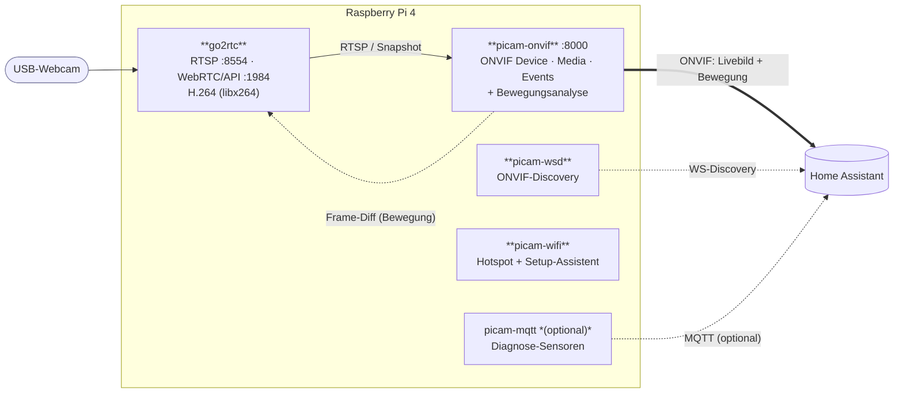
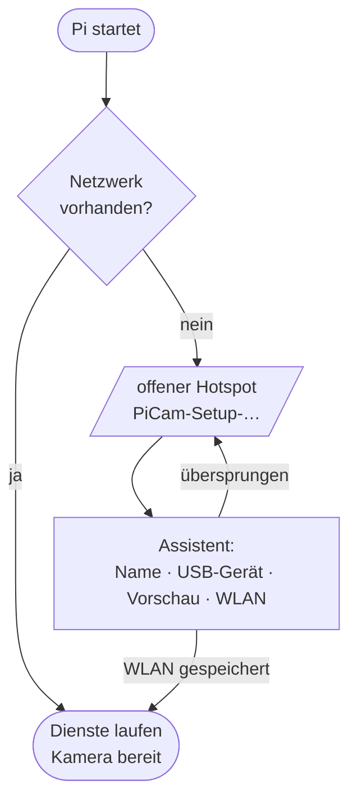
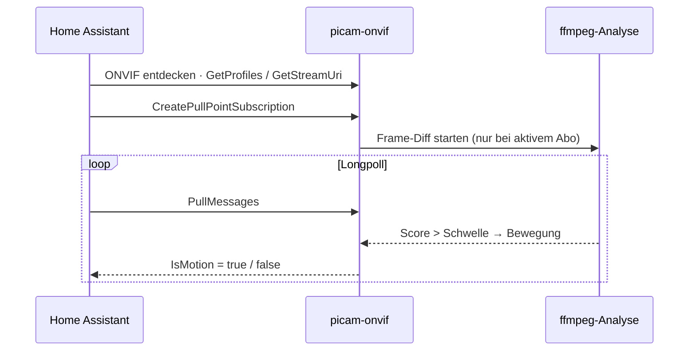

# PiCam

**Raspberry Pi 4 + USB-Webcam → Überwachungskamera für Home Assistant.**
Ein Gerät, das sich in HA automatisch als **ONVIF-Kamera mit Livebild *und* Bewegungssensor**
meldet – lokal, ohne Cloud, ohne Abo.

- 📹 **Livebild** über ONVIF/WebRTC (go2rtc), geringe Latenz
- 🟢 **Lokale Bewegungserkennung** als ONVIF-Ereignis – ideal für Licht- & Alarm-Automationen
- 📶 **Einrichtungs-Assistent** per WLAN-Hotspot, falls kein Netz erreichbar ist
- 🔒 Alles bleibt im Heimnetz; Zugangsdaten liegen nur auf dem Pi

---

## 1. Schnellstart

**Voraussetzungen:** Raspberry Pi 4, Raspberry Pi OS Lite 64-bit (Bookworm oder Trixie),
USB-Webcam angeschlossen, SSH-Zugang.

```bash
# auf dem Entwicklungsrechner: Paket auf den Pi kopieren
scp picam-1.0.tar.gz <benutzer>@<pi>:

# auf dem Pi: entpacken und installieren ("Keller" = Name der Kamera)
tar xzf picam-1.0.tar.gz
cd picam
sudo bash install.sh "Keller"
```

Der Installer installiert die Pakete, lädt go2rtc, erkennt die Webcam automatisch
(Format/Auflösung/Bildrate), erzeugt Zufallspasswörter und startet alle Dienste.
Zum Schluss zeigt er die Zugangsdaten an – diese stehen auch in `/etc/picam/picam.conf`.

**Prüfen:** Livebild im Browser unter `http://<pi>.local:1984` → *Streams → picam*.

> Optionen: `WIFI_COUNTRY=AT sudo bash install.sh …` (WLAN-Land, Standard DE) ·
> `MQTT_USER=… MQTT_PASSWORD=… sudo -E bash install.sh …` (optionale MQTT-Diagnose).

---

## 2. In Home Assistant einbinden

Die Kamera meldet sich per ONVIF – **ein Gerät mit Livebild und Bewegungssensor**:

1. **Einstellungen → Geräte & Dienste → Integration hinzufügen → ONVIF**
2. „Keller" sollte im Scan erscheinen. Falls nicht, *manuell konfigurieren*:
   **Host** = IP des Pi, **Port** = `8000`, **Benutzer** `admin`, **Passwort** aus `picam.conf`.
3. Fertig: Es erscheinen eine **Kamera-Entität** (Livebild per WebRTC) und ein
   **`binary_sensor` „Bewegung"**.

> HA und Pi müssen im selben Netz sein, Multicast darf nicht blockiert sein (kein Gäste-WLAN).

> **Hinweis:** Die ONVIF-Integration von HA sucht nur, wenn du sie wie oben hinzufügst –
> eine ONVIF-Kamera taucht **nicht** von selbst unter „Entdeckt" auf. Nach der Einrichtung
> erkennt HA die Kamera über ihre MAC-Adresse wieder (z. B. bei neuer IP per DHCP).

---

## 3. WLAN einrichten (ohne Kabel)

Findet der Pi beim Start **kein** Netzwerk (kein LAN-Kabel, kein bekanntes WLAN), öffnet er
das **offene** WLAN `PiCam-Setup-…`. Beim Verbinden mit dem Handy startet automatisch ein
**Schritt-für-Schritt-Assistent**:

> **Start → Kamera** (Name, USB-Gerät, Format/Auflösung) **→ Vorschau → WLAN**

Den Assistenten kannst du jederzeit – auch am Kabel – manuell starten:

```bash
sudo picam-wifi portal      # Hotspot + Assistent sofort (Abbruch mit Strg-C)
```

---

## 4. Konfiguration

### Weboberfläche

Unter **`http://<pi>.local`** (Port 80) gibt es eine Einstellungsseite – Anmeldung mit
Benutzer `admin` und dem Kamera-Passwort. Dort: Vorschaubild, Anleitung + Zugangsdaten für
Home Assistant, Kamera (Name, Gerät, Format, Auflösung, Bildrate), Bewegungserkennung,
Passwort ändern, Netzwerkstatus, Dienste neu starten.

Nach 5 falschen Anmeldungen ist die Adresse 10 Minuten gesperrt.

> **Zugriff von unterwegs über die FRITZ!Box:** Am sichersten per **FRITZ!Box-VPN**
> (WireGuard) – dann ist die Seite wie zu Hause erreichbar und nichts ist offen im Internet.
> Eine Portfreigabe auf Port 80 funktioniert auch, überträgt das Passwort aber
> **unverschlüsselt** (HTTP). Ports `1984`, `8554` und `8000` **nie** freigeben –
> go2rtc auf `1984` hat keinen Passwortschutz.

### picam.conf

Einstellungen in `/etc/picam/picam.conf` (danach `sudo systemctl restart go2rtc picam-onvif`):

| Schlüssel | Bedeutung |
|---|---|
| `CAM_NAME` | Anzeigename der Kamera |
| `CAM_USER`, `CAM_PASSWORD` | Zugang für RTSP/ONVIF |
| `VIDEO_DEVICE`, `VIDEO_FORMAT`, `VIDEO_SIZE`, `FRAMERATE` | Webcam-Quelle – bei der Installation automatisch erkannt (bevorzugt MJPEG 1280×720) |
| `ROTATE` | Ausrichtung im Uhrzeigersinn: `0`, `90`/`270` (Hochformat), `180` (kopfüber). Auch in der Weboberfläche/im Assistenten einstellbar. Kostet etwas CPU; H.264-Kameras werden dafür neu kodiert. |
| `OVERLAY_TIME` | `1` = Datum/Uhrzeit (Ortszeit des Pi) unten rechts ins Bild, `0` = aus. In der Weboberfläche schaltbar. Kostet nur wenige Prozent CPU. |
| `BITRATE` | H.264-Bitrate (Standard `2500k`) |
| `HW_ENCODE` | `0` = Software-Encoder (libx264, **Standard**, ~1 Kern bei 720p30). `1` = Pi-Hardware-Encoder (v4l2m2m) – spart CPU, **lässt aber WebRTC/MSE im Browser einfrieren**; dann geht nur RTSP. |
| `MOTION_ENABLE`, `MOTION_SENSITIVITY` | Bewegungserkennung an/aus (`0`/`1`) und Empfindlichkeit `0`–`100` (höher = empfindlicher). Feintuning: `MOTION_FPS`, `MOTION_COOLDOWN`, optional `MOTION_THRESHOLD` (absolute Pixeldifferenz). |
| `ONVIF_PORT` | Port des ONVIF-Servers (Standard `8000`) |
| `AP_SSID`, `AP_PASSWORD` | Einrichtungs-WLAN (leeres Passwort = offen) |

**Befehle:**

```bash
sudo picam-wifi status      # Netz-/Hotspot-Status anzeigen
sudo picam-wifi reset       # gespeicherte WLANs löschen → Einrichtungsmodus
sudo picam-wifi portal      # Assistent on-demand starten
systemctl status go2rtc picam-onvif picam-wsd picam-wifi
```

**Ports:** RTSP `8554` (mit Passwort) · go2rtc-API/WebUI `1984` · WebRTC `8555` · ONVIF `8000`.

---

## 5. Systemaufbau

### Komponenten & Datenfluss



### Einrichtungs-Ablauf beim Start



### Bewegung in Home Assistant (ONVIF-Events)



**Warum ein eigener ONVIF-Server?** go2rtcs eingebautes ONVIF kann keine Bewegungs-Events.
`picam-onvif` spricht ONVIF selbst (Device/Media/Events) und verweist fürs Video auf go2rtc –
so erscheint in HA **ein** Gerät mit Livebild *und* Bewegung, ganz ohne MQTT-Broker.

**Wie wird Bewegung erkannt?** `picam-onvif` lässt ffmpeg winzige Graubilder (64×36) aus dem
Stream ziehen und misst die mittlere Pixeldifferenz zweier Bilder. Übersteigt sie die aus
`MOTION_SENSITIVITY` abgeleitete Schwelle (mit Entprellung), gilt es als Bewegung. Die Analyse
läuft **nur, solange HA Ereignisse abonniert** – das spart Strom und CPU.

---

## 6. Fehlersuche

| Symptom | Ursache / Lösung |
|---|---|
| **Livebild läuft kurz, dann Standbild** (Browser/WebRTC) | `HW_ENCODE='1'` gesetzt – der Hardware-Encoder bricht WebRTC/MSE. Auf `0` (Software) stellen. |
| **Bild ruckelt / CPU hoch** | `VIDEO_SIZE` oder `FRAMERATE` verkleinern. |
| **Kein Bild** | `http://<pi>:1984` → *Streams → picam*. `VIDEO_FORMAT`/`VIDEO_SIZE` prüfen. |
| **Bewegung löst nie / ständig aus** | `MOTION_SENSITIVITY` anpassen (danach `sudo systemctl restart picam-onvif`); zum Beobachten `journalctl -u picam-onvif -f`. |
| **HA findet die Kamera nicht** | Selbes Netz? Multicast frei? Sonst ONVIF *manuell*: Host `<Pi-IP>`, Port `8000`. |
| **Kamera in HA eingerichtet, aber kein Livebild** | Falsche Zugangsdaten beim Einrichten (HA nutzt sie auch für RTSP). ONVIF-Eintrag löschen und mit `admin` + Passwort neu hinzufügen. |
| **„Unerwarteter Fehler"/ONVIF-Fehler nach Eingabe des Passworts** | `journalctl -u picam-onvif` auf „Unbekannte ONVIF-Operation" prüfen – HA verlangt eine Operation, die der Server nicht kennt. |
| **Captive Portal erscheint nicht** | Der Hotspot startet nur **offline**. Am Kabel: `sudo picam-wifi portal`. WLAN-Land gesetzt? (`raspi-config`) |

---

## 7. Sicherheit

- RTSP/ONVIF sind mit Benutzer/Passwort geschützt (zufällig erzeugt, in `/etc/picam/picam.conf`, `0640`).
- Die go2rtc-API auf `:1984` ist im Heimnetz **ohne** Auth erreichbar – nicht ins Internet weiterleiten.
- Die Weboberfläche (Port 80) ist mit Benutzer/Passwort geschützt, sperrt nach Fehlversuchen
  und nimmt Formulare nur von sich selbst an. Im Einrichtungs-WLAN ist der Assistent offen.
- Kein Cloud-Dienst, keine ausgehenden Verbindungen außer zu deinem Home Assistant.

---

## Dienste im Überblick

| Dienst | Aufgabe |
|---|---|
| `go2rtc` | Video: Kamera → H.264, RTSP/WebRTC/Snapshot |
| `picam-onvif` | ONVIF-Server (Livebild-Verweis + Bewegungs-Events) |
| `picam-wsd` | ONVIF-Discovery (macht die Kamera in HA auffindbar) |
| `picam-wifi` | Hotspot + Einrichtungs-Assistent, wenn kein Netz da ist |
| `picam-mqtt` | *optional:* Diagnose-Sensoren (CPU-Temp, WLAN, IP) via MQTT |
